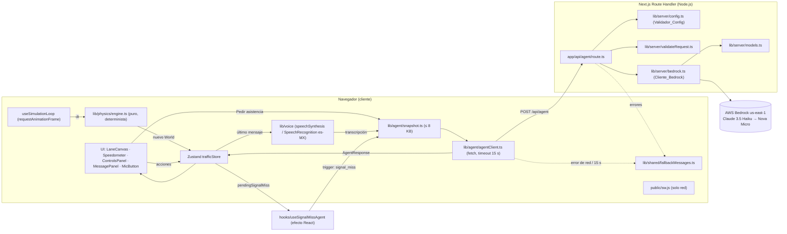
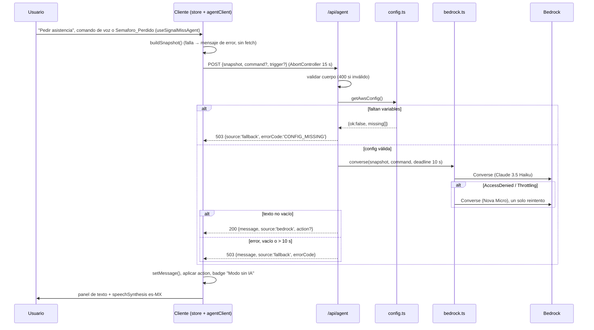

# Design Document

## Overview

"Agente Inteligente de Micro-Flujo y Asistencia Vial" es una PWA en Next.js (App Router + TypeScript + Tailwind) que simula 3 carriles de una vía rápida tipo Periférico y muestra cómo un frenado brusco genera un "efecto acordeón". El sistema separa dos responsabilidades:

- **Física determinista en el cliente.** Un motor puro en TypeScript (`lib/physics`) calcula la cinemática de cada automóvil. Un hook con `requestAnimationFrame` lo invoca en cada cuadro y guarda el resultado en un store de Zustand. No hay llamadas de red en este camino.
- **Comunicación humana con IA en el servidor.** Un Route Handler (`app/api/agent/route.ts`) recibe un snapshot JSON del tráfico (y opcionalmente un comando de voz transcrito), hace una sola llamada Converse sin streaming a AWS Bedrock y devuelve un mensaje corto en español. Si Bedrock no está disponible, responde con un mensaje de respaldo predefinido ("Modo sin IA").

La voz usa la Web Speech API del navegador (`speechSynthesis` y `SpeechRecognition` en `es-MX`). La aplicación se ejecuta en `localhost:3000` y se despliega en Vercel. Es instalable, pero no funciona sin conexión.

### Decisiones clave

| Decisión | Elección | Motivo |
|---|---|---|
| Render de carriles | SVG (no Canvas) | 12 vehículos es poco para el DOM; SVG da clic/tap por elemento sin hit-testing manual y se estiliza con Tailwind. |
| Estado | Zustand con un motor puro `stepWorld(world, dt)` | El motor se puede probar desde la consola sin React; el store solo guarda el resultado. |
| SDK de Bedrock | `@aws-sdk/client-bedrock-runtime`, `ConverseCommand` | La API Converse es la misma para Claude y Nova, así el reintento con el modelo de respaldo no cambia el formato. |
| IDs de modelo | Inference profiles `us.*` en un solo archivo de constantes | Claude 3.5 Haiku no admite invocación on-demand con el ID base del modelo; hay que usar el ID de un inference profile de sistema ([re:Post](https://repost.aws/questions/QUnw6hlTrPRlS5BMu1BTfQhA/bedrock-api-with-cross-region-inference-is-not-working), [Stack Overflow](https://stackoverflow.com/posts/79428476/revisions)). El prefijo `us.` solo se resuelve desde regiones de EE. UU. como us-east-1. |
| Interpretación de comandos de voz | El modelo responde JSON `{message, action}`; si el JSON no se puede leer, una expresión regular determinista sobre la transcripción decide `action` | Haiku y Nova Micro casi siempre siguen el formato, y la regex evita que la demo dependa de eso. |
| Protección de credenciales | `import 'server-only'` en `lib/server/*` | Next.js falla el build si un componente cliente importa esos módulos (Req. 1.2). |
| Variables en Vercel | `AWS_ACCESS_KEY_ID`, `AWS_SECRET_ACCESS_KEY`, `AWS_REGION` como variables normales del proyecto | Vercel permite estas variables para configurar el AWS SDK en sus funciones ([Vercel KB](https://vercel.com/kb/guide/how-can-i-use-aws-sdk-environment-variables-on-vercel)). Se pasan de forma explícita al cliente del SDK, no por la cadena de credenciales por defecto. |
| Pruebas | Solo checklist manual en el README; sin PBT ni fast-check | Decisión explícita del equipo por el límite de 150 minutos (Req. 14.5). |

### Resultados de la investigación

- **Inference profiles.** Para Claude 3.5 Haiku se usa `us.anthropic.claude-3-5-haiku-20241022-v1:0`. Con el ID base `anthropic.claude-3-5-haiku-20241022-v1:0`, Bedrock devuelve `ValidationException` ("on-demand throughput isn't supported"). Para Nova Micro se usa `us.amazon.nova-micro-v1:0`. Los dos IDs viven en `lib/server/models.ts`, así que cambiarlos es editar una línea.
- **Vercel.** Las variables AWS se pueden definir en el proyecto. El Route Handler solo exporta `maxDuration = 15` para que el límite de 10 s de Bedrock más el procesamiento quepa en el tiempo de la función.
- **Next.js 16.4.6 con `cacheComponents: true`** (verificado en la Tarea 1). Con esta opción, `route.ts` no puede exportar `runtime` ni `dynamic`: la configuración de segmento no es compatible y rompe el build. No hace falta, porque un handler `POST` nunca se cachea y corre en Node.js por defecto. Toda mención anterior a `runtime = 'nodejs'` o `dynamic = 'force-dynamic'` queda eliminada de este diseño.
- **Tailwind 4.3 (CSS-first).** No hay `tailwind.config.*`. Los tokens de color se declaran en el bloque `@theme` de `app/globals.css`.
- **Node.js ≥ 20.9.** Es la versión mínima de Next.js 16 (Req. 12.4).
- **Instalación de la PWA.** Chrome pide manifest con `name`/`short_name`, íconos de 192 y 512 px, `start_url`, `display: standalone` y HTTPS (o `localhost`). Un service worker con un `fetch` que solo reenvía a la red basta y no crea caché.

## Architecture

### Vista general



### Flujo de una solicitud de asistencia



El bucle de simulación nunca espera esta solicitud. El `fetch` es asíncrono y el store solo cambia cuando llega la respuesta (Req. 11.5).

### Estructura de carpetas por rol

```
/
├─ app/
│  ├─ layout.tsx                 # metadata, theme color, <ServiceWorkerRegister/>        (I3)
│  ├─ page.tsx                   # compone la pantalla principal                          (I3)
│  ├─ manifest.ts                # Web App Manifest (metadata route de Next)              (I3)
│  ├─ globals.css                # Tailwind 4 (`@import "tailwindcss"` + tokens en @theme) (I3)
│  └─ api/agent/route.ts         # Endpoint_Agente                                        (I1)
├─ lib/
│  ├─ server/                    # SOLO servidor, todos con `import 'server-only'`        (I1)
│  │  ├─ config.ts               # Validador_Config (único lector de process.env.AWS_*)
│  │  ├─ models.ts               # IDs de modelos y parámetros de inferencia
│  │  ├─ bedrock.ts              # Cliente_Bedrock (Converse + reintento + timeout)
│  │  ├─ prompt.ts               # system prompt y armado del mensaje de usuario
│  │  ├─ validateRequest.ts      # validación del cuerpo POST
│  │  └─ errors.ts               # mapeo de errores del SDK a ErrorCode
│  ├─ shared/                    # usable en cliente y servidor (sin secretos)            (I1)
│  │  ├─ contracts.ts            # AgentRequest, AgentResponse, TrafficSnapshot, ErrorCode
│  │  ├─ fallbackMessages.ts     # TODOS los Mensaje_Respaldo
│  │  └─ roadContext.ts          # vía CDMX, sentido, tramo e incorporaciones
│  ├─ agent/                     # cliente                                                (I1)
│  │  ├─ snapshot.ts             # buildSnapshot + serializeSnapshot (≤ 8192 bytes)
│  │  └─ agentClient.ts          # requestAssistance() con timeout 15 s
│  ├─ physics/                   #                                                        (I2)
│  │  ├─ constants.ts            # 8 m, 30 m, -5.88, 2.94, 200 m, 27.8 m/s, 0.1 s
│  │  ├─ types.ts                # Automovil, CarControl, World, BrakeEvent, SignalState, SignalMissEvent
│  │  ├─ engine.ts               # stepWorld(world, dt) puro
│  │  ├─ signal.ts               # signalStateAt, computeTta, greenWaveSpeedKmh, resolveUserCarId (puras)  (I2)
│  │  └─ scenario.ts             # 10 autos iniciales + 2 fantasmas (datos fijos)
│  └─ voice/                     #                                                        (I4)
│     ├─ speech.ts               # speak(text) con cancelación previa
│     └─ recognition.ts          # startListening() es-MX, una sesión
├─ store/
│  └─ trafficStore.ts            # Store_Trafico (Zustand)                                (I2)
├─ hooks/
│  ├─ useSimulationLoop.ts       # Bucle_Simulacion                                       (I2)
│  └─ useSignalMissAgent.ts      # dispara askAgent(undefined, 'signal_miss')             (I1)
├─ components/
│  ├─ road/LaneCanvas.tsx        # Lienzo_Carriles (SVG)                                  (I3)
│  ├─ speedometer/Speedometer.tsx# Velocimetro                                            (I3)
│  ├─ controls/ControlsPanel.tsx # botones                                                (I3)
│  ├─ messages/MessagePanel.tsx  # panel + badge "Modo sin IA"                            (I3)
│  ├─ pwa/ServiceWorkerRegister.tsx #                                                     (I3)
│  └─ voice/MicButton.tsx        # botón de micrófono                                     (I4)
├─ public/
│  ├─ sw.js                      # service worker network-only                            (I3)
│  └─ icons/icon-192.png, icon-512.png                                                    (I3)
├─ .env.example                  #                                                        (I1)
├─ .gitignore                    #                                                        (I1)
└─ README.md                     # incluye guion de demo y checklist manual               (I4)
```

Leyenda: I1 = Integrante 1 (AWS/Arquitectura), I2 = Integrante 2 (Física), I3 = Integrante 3 (UI), I4 = Integrante 4 (Voz/Pitch y demo).

Regla de dependencias: `lib/physics` no importa nada de React, del store ni de la red. `lib/server` solo lo importa `app/api`. `lib/shared` no lee `process.env`.

## Components and Interfaces

### Integrante 1: servidor y Bedrock

#### `lib/server/config.ts` (Validador_Config)

```ts
import 'server-only';

export const REQUIRED_ENV = ['AWS_ACCESS_KEY_ID', 'AWS_SECRET_ACCESS_KEY', 'AWS_REGION'] as const;
export type RequiredEnv = typeof REQUIRED_ENV[number];

export type AwsConfigResult =
  | { ok: true; accessKeyId: string; secretAccessKey: string; region: string }
  | { ok: false; missing: RequiredEnv[] };   // orden fijo de REQUIRED_ENV, sin valores

export function getAwsConfig(): AwsConfigResult;
```

- Lee las variables en cada llamada (no en el import), así un cambio en `.env.local` se toma al reiniciar el servidor sin cambiar código.
- Un valor es "vacío" si es `undefined`, `''` o `value.trim() === ''`.
- Recorre `REQUIRED_ENV` en orden y acumula todos los faltantes.
- No hay región por defecto. Si falta `AWS_REGION`, aparece en `missing`.
- Es el único archivo que contiene la cadena `process.env.AWS_` (Req. 2.1). Para comprobarlo: buscar `AWS_ACCESS_KEY_ID` con grep en `app/` y `lib/`.

#### `lib/server/models.ts`

```ts
import 'server-only';
export const PRIMARY_MODEL_ID  = 'us.anthropic.claude-3-5-haiku-20241022-v1:0'; // inference profile
export const FALLBACK_MODEL_ID = 'us.amazon.nova-micro-v1:0';                    // inference profile
// Si la cuenta tiene acceso on-demand directo, se pueden cambiar por:
// 'anthropic.claude-3-5-haiku-20241022-v1:0' / 'amazon.nova-micro-v1:0'
export const INFERENCE_CONFIG = { maxTokens: 200, temperature: 0.4 } as const;
export const BEDROCK_DEADLINE_MS = 10_000;
```

#### `lib/server/bedrock.ts` (Cliente_Bedrock)

```ts
import 'server-only';
export type BedrockOutcome =
  | { ok: true; text: string; modelId: string }
  | { ok: false; errorCode: 'AUTH_ERROR' | 'QUOTA_EXCEEDED' | 'TIMEOUT' | 'EMPTY_RESPONSE' | 'BEDROCK_ERROR' };

export async function converseWithFallback(args: {
  config: { accessKeyId: string; secretAccessKey: string; region: string };
  system: string;
  userText: string;
  signal: AbortSignal;          // se aborta a los 10 s desde la recepción de la solicitud
}): Promise<BedrockOutcome>;
```

Algoritmo:

```
client = new BedrockRuntimeClient({ region: config.region,
          credentials: { accessKeyId, secretAccessKey }, maxAttempts: 1 })
try:
  out = client.send(ConverseCommand(PRIMARY_MODEL_ID, system, userText, INFERENCE_CONFIG), { abortSignal: signal })
except e:
  if signal.aborted: return TIMEOUT
  if not isRetryableForFallback(e): return mapError(e)
  try:
    out = client.send(ConverseCommand(FALLBACK_MODEL_ID, ...mismos args), { abortSignal: signal })
  except e2:
    if signal.aborted: return TIMEOUT
    return mapError(e2)
text = concatenar out.output.message.content[*].text
if text.trim() == '': return EMPTY_RESPONSE
return { ok: true, text, modelId }
```

`maxAttempts: 1` desactiva los reintentos automáticos del SDK. Así se cumple "exactamente un reintento" con Nova Micro y el tiempo total queda acotado.

#### `lib/server/errors.ts`

| `error.name` del SDK | ¿Dispara el reintento con Nova Micro? | `ErrorCode` final |
|---|---|---|
| `AccessDeniedException` | Sí | `AUTH_ERROR` |
| `ThrottlingException` | Sí | `QUOTA_EXCEEDED` |
| `ServiceQuotaExceededException` | Sí (cuota = limitación de tasa) | `QUOTA_EXCEEDED` |
| `ValidationException` con texto "on-demand throughput" o modelo inválido | Sí (acceso al modelo) | `AUTH_ERROR` |
| `UnrecognizedClientException`, `InvalidSignatureException`, `ExpiredTokenException` | No (las credenciales son las mismas para los dos modelos) | `AUTH_ERROR` |
| `AbortError` / `signal.aborted` | No | `TIMEOUT` |
| Otro | No | `BEDROCK_ERROR` |

Incluir `ValidationException` por ID de modelo en el reintento es una decisión de diseño: protege la demo si el inference profile de Haiku no está habilitado. Los registros (`console.error`) solo guardan `error.name` y `modelId`, nunca el objeto de error completo ni `$metadata` con encabezados (Req. 9.7).

#### `lib/server/prompt.ts`

```ts
export const SYSTEM_PROMPT: string;  // en español
export function buildUserText(snapshot: TrafficSnapshot, command?: string, trigger?: AgentTrigger): string;
export function parseModelOutput(raw: string, command?: string): { message: string; action?: AgentAction };
export function enforceSignalMissMessage(message: string, kmh: number): string; // ver "Semaforo_Perdido" abajo
```

Contenido del system prompt (agente de movilidad de la CDMX, ver "Localización CDMX"):
- Eres el copiloto del Centro de Movilidad de la CDMX y monitoreas el tramo de `ROAD_CONTEXT.name` (Viaducto Miguel Alemán). Hablas en español de México, en tono operativo, breve y calmado, como un aviso de tráfico.
- Estructura del mensaje: (1) qué se detectó y dónde, usando el nombre de la incorporación más cercana (`nearestRamp`); (2) qué hace el sistema (por ejemplo, "Amortiguando onda de choque"); (3) una instrucción concreta con la velocidad sugerida en km/h (`suggestedSpeedKmh`).
- Máximo 3 oraciones cortas y 300 caracteres.
- Un Auto_Fantasma se describe como "vehículo sin conexión". Los demás autos se mencionan por su `description` (por ejemplo, "el Honda Fit azul"), nunca por su `id`.
- Responde solo un JSON `{"message": string, "action": "enable_damper" | "disable_damper" | null}`.
- Usa `action` solo si el comando de voz pide activar o desactivar el amortiguador.
- Ejemplo de estilo: "Vehículo sin conexión detectado en la incorporación de Río Becerra. Amortiguando onda de choque. Reduce a 35 km/h para evitar frenado total en Viaducto."
- Regla de Semaforo_Perdido (Req. 18.3, 18.4): si el bloque de contexto dice `TRIGGER: signal_miss`, el mensaje ignora la estructura anterior y debe nombrar el semáforo, decir que el conductor no alcanza a pasar, pedir que suelte el acelerador, dar **exactamente** la velocidad sugerida recibida (sin calcular ni redondear otra) y mencionar el ahorro de gasolina. Ejemplo: "No alcanzas el semáforo de Eje Central. Suelta el acelerador y mantén 20 km/h para llegar justo cuando cambie a verde, ahorrando gasolina." `action` va en `null`.

`buildUserText` agrega al snapshot un bloque de contexto calculado en el servidor de forma determinista: el nombre de la vía, la incorporación más cercana al último Frenado_Brusco (`nearestRamp(y)` con `ROAD_CONTEXT.ramps`) y `suggestedSpeedKmh`. Este último es la velocidad mínima en km/h de los autos del carril afectado, redondeada hacia abajo a múltiplo de 5 y acotada a [20, 60]. Sin eventos de frenado se usa 60. El bloque siempre incluye el estado del semáforo (`snapshot.signal`: nombre, color y segundos restantes).

Cuando `trigger === 'signal_miss'` y `snapshot.lastSignalMiss` no es `null`, `buildUserText` agrega este bloque de instrucción (los números salen tal cual del snapshot, el servidor no los recalcula):

```
TRIGGER: signal_miss
Semáforo: {snapshot.signal.name}
Auto: {descripción del auto lastSignalMiss.carId en snapshot.cars, o "tu auto"}
TTA: {ttaS} s · verde restante: {greenRemainingS} s
Velocidad sugerida EXACTA: {suggestedKmh} km/h
Redacta la instrucción de Semaforo_Perdido. Usa exactamente "{suggestedKmh} km/h". No calcules otros números.
```

Si `trigger === 'signal_miss'` pero `lastSignalMiss` es `null`, se trata como `manual` (no hay número que dar).

**Comprobación determinista del número (decisión).** El modelo puede cambiar la cifra. Para que el mensaje del camino Bedrock también sea exacto (Req. 18.4), `route.ts` aplica `enforceSignalMissMessage(message, kmh)` después de `parseModelOutput` cuando `trigger === 'signal_miss'`:

```
if message.includes(`${kmh} km/h`): return message
return buildSignalMissFallback(kmh).replace(/\.$/, '') + ', ahorrando gasolina.'
// "No alcanzas el semáforo de Eje Central. Suelta el acelerador y mantén N km/h para llegar en verde, ahorrando gasolina."
```

La respuesta sigue con `source: 'bedrock'` (la solicitud a Bedrock sí funcionó), así que no aparece el badge "Modo sin IA". Se eligió reemplazar el mensaje completo en vez de anexar la cifra, porque un mensaje con dos velocidades distintas confundiría al conductor.

`parseModelOutput`:
1. Busca el primer bloque `{...}` y aplica `JSON.parse`. Si `message` es string no vacío, lo usa.
2. Si falla, toma el texto crudo como `message`.
3. `action`: se acepta el valor del JSON solo si es `enable_damper` o `disable_damper`. Si no hay JSON válido y hay `command`, aplica la regex `/\b(desactiva|apaga)\w*\b.*amortigu/i` → `disable_damper`, y si no coincide, `/\b(activa|enciende|prende)\w*\b.*amortigu/i` → `enable_damper`. La de desactivar va primero porque "desactivar" contiene "activar".
4. Recorta `message` a 3 oraciones y a 300 caracteres (corta en el último espacio antes de 300).

#### `lib/server/validateRequest.ts`

```ts
export type ValidationResult =
  | { ok: true; snapshot: TrafficSnapshot; command?: string; trigger?: AgentTrigger }
  | { ok: false; reason: 'NOT_JSON' | 'MISSING_FIELD' | 'WRONG_TYPE' | 'TOO_LARGE'; detail: string };
export function validateAgentRequest(rawBody: string): ValidationResult;
```

- `TOO_LARGE` si `byteLength(rawBody) > 8192 + 2048` (8 KB del snapshot + 500 caracteres de comando con margen para multibyte y el envoltorio), o si `byteLength(JSON.stringify(body.snapshot)) > 8192`.
- `NOT_JSON` si `JSON.parse` falla.
- `MISSING_FIELD` / `WRONG_TYPE` con un type guard escrito a mano para cada campo de `TrafficSnapshot` (sin zod, para no añadir dependencias). `detail` nombra el campo, por ejemplo `"snapshot.cars[3].lane"`.
- `command`, si viene, debe ser string. Se recorta a 500 caracteres.
- `trigger`, si viene, debe ser exactamente `'manual'`, `'voice'` o `'signal_miss'`. Cualquier otro valor (incluido un tipo distinto de string) devuelve `WRONG_TYPE` con `detail: "trigger"` → HTTP 400 sin llamar a Bedrock (Req. 18.5). `ErrorCode` no cambia: sigue siendo `INVALID_REQUEST`.
- `snapshot.signal` es obligatorio: `name` string, `color` `'green' | 'red'`, `remainingS` número finito. `snapshot.lastSignalMiss` es obligatorio pero puede ser `null`; si es objeto, cada campo de `SnapshotSignalMiss` se valida con su tipo (`detail` como `"snapshot.lastSignalMiss.suggestedKmh"`).

#### `app/api/agent/route.ts` (Endpoint_Agente)

```ts
// Next.js 16 + cacheComponents: NO exportar `runtime` ni `dynamic` (no soportado).
// POST no se cachea y corre en Node.js por defecto.
export const maxDuration = 15;
export async function POST(req: Request): Promise<Response>;
```

```
start = now; controller = new AbortController(); timer = setTimeout(abort, 10_000)
raw = await req.text()
v = validateAgentRequest(raw)
if !v.ok: return 400 { message: FALLBACK.INVALID_REQUEST, source:'fallback', errorCode:'INVALID_REQUEST', detail: v.reason + ': ' + v.detail }
cfg = getAwsConfig()
if !cfg.ok: return 503 { message: FALLBACK.CONFIG_MISSING, source:'fallback', errorCode:'CONFIG_MISSING', missing: cfg.missing }
r = await converseWithFallback({ config: cfg, system: SYSTEM_PROMPT, userText: buildUserText(v.snapshot, v.command, v.trigger), signal })
clearTimeout(timer)
miss = v.trigger == 'signal_miss' ? v.snapshot.lastSignalMiss : null
if r.ok: { message, action } = parseModelOutput(r.text, v.command)
         if miss: message = enforceSignalMissMessage(message, miss.suggestedKmh); action = undefined
         return 200 { message, source:'bedrock', action }
code = r.errorCode == 'EMPTY_RESPONSE' ? 'EMPTY_RESPONSE' : r.errorCode
msg  = miss ? buildSignalMissFallback(miss.suggestedKmh) : fallbackFor(code)
return 503 { message: msg, source:'fallback', errorCode: code }
```

Una respuesta vacía del modelo devuelve 503 con `source: 'fallback'` (Req. 9.8). Ningún camino incluye credenciales ni trazas del SDK. El cliente vuelve a reemplazar el mensaje en el caso `signal_miss` + fallback (ver `askAgent`), así el texto exacto de Req. 17.9 no depende de qué lado generó el respaldo.

#### `lib/agent/agentClient.ts` (cliente)

```ts
export async function requestAgent(snapshotJson: string, command?: string, trigger?: AgentTrigger): Promise<AgentResponse>;
```

- Arma el cuerpo como texto, `'{"snapshot":' + snapshotJson + (command ? ',"command":' + JSON.stringify(command) : '') + (trigger ? ',"trigger":' + JSON.stringify(trigger) : '') + '}'`, para no volver a serializar el snapshot.
- `AbortController` de 15 s. Ante un error de red, un abort o una respuesta que no es JSON, devuelve un `AgentResponse` local: `{ message: buildLocalFallback(lastBrakeEvent, cars), source: 'fallback', errorCode: 'NETWORK_ERROR' }`.
- Las respuestas 400 y 503 traen un cuerpo `AgentResponse` válido y se devuelven tal cual.

#### `lib/agent/snapshot.ts`

```ts
export function buildSnapshot(state: TrafficState, nowIso: string): TrafficSnapshot;
export function serializeSnapshot(s: TrafficSnapshot): string; // garantiza ≤ 8192 bytes
export const SNAPSHOT_MAX_BYTES = 8192;
```

```
round1(x) = Math.round(x * 10) / 10            // y -0 se normaliza a 0
cars = state.cars ordenados por id → { id, description, lane, y: round1(y), speedKmh: round1(v*3.6), accel: round1(a), isGhost }
events = state.brakeEvents.slice(-5).reverse()  → { carId, lane, y: round1, t: round1 }
sig = state.signal                               // SignalState del último tick
miss = state.signalMissEvents.at(-1) ?? null
signal = { name: ROAD_CONTEXT.signal.name, color: sig.color, remainingS: round1(sig.remainingS) }
lastSignalMiss = miss ? { carId, y: round1, ttaS: round1(ttaS), greenRemainingS: round1, suggestedKmh, cycleIndex, t: round1 } : null
snap = { timestamp: nowIso, damperEnabled, totalCars: cars.length, truncated: false, cars, recentHardBrakes: events, signal, lastSignalMiss }
json = JSON.stringify(snap)
while bytes(json) > 8192:
   idx = último índice de cars con isGhost == false
   if idx < 0: throw SnapshotTooLargeError
   cars.splice(idx, 1); snap.truncated = true; json = JSON.stringify(snap)
return json
```

`bytes(s) = new TextEncoder().encode(s).length`. Como los números ya vienen redondeados con `round1`, `JSON.stringify(JSON.parse(json)) === json` (Req. 8.4). El llamador envuelve `buildSnapshot` y `serializeSnapshot` en `try/catch`. Si fallan, muestra `FALLBACK.SNAPSHOT_ERROR` y no llama a `requestAgent` (Req. 8.7).

#### `lib/shared/fallbackMessages.ts`

```ts
export const FALLBACK_MESSAGES = {
  CONFIG_MISSING: 'Modo sin IA: faltan credenciales de AWS. La simulación sigue funcionando.',
  AUTH_ERROR:     'Modo sin IA: no hay acceso al modelo en AWS Bedrock. Mantén tu distancia y frena con suavidad.',
  QUOTA_EXCEEDED: 'Modo sin IA: se alcanzó el límite de uso del agente. Conserva 8 metros con el auto de enfrente.',
  TIMEOUT:        'Modo sin IA: el agente tardó demasiado. Reduce la velocidad de forma gradual.',
  EMPTY_RESPONSE: 'Modo sin IA: el agente no generó respuesta. Mantén una distancia segura.',
  BEDROCK_ERROR:  'Modo sin IA: el agente no está disponible. Mantén una distancia segura.',
  NETWORK_ERROR:  'Modo sin IA: sin conexión con el agente. Mantén una distancia segura.',
  INVALID_REQUEST:'No se pudo procesar la solicitud al agente.',
  SNAPSHOT_ERROR: 'No se pudo obtener el contexto del tráfico.',
  VOICE_CAPTURE_ERROR: 'No se pudo capturar el comando de voz. Intenta de nuevo.',
  SIMULATION_ERROR: 'La simulación se detuvo por un error.',
  NO_MESSAGES: 'Aún no hay mensajes.',
  // Plantilla de Semaforo_Perdido (Req. 11.6, 17.9). {signal} y {kmh} se sustituyen en buildSignalMissFallback.
  SIGNAL_MISS: 'No alcanzas el semáforo de {signal}. Suelta el acelerador y mantén {kmh} km/h para llegar en verde.',
} as const;

export function buildSignalMissFallback(kmh: number): string;
// FALLBACK_MESSAGES.SIGNAL_MISS.replace('{signal}', ROAD_CONTEXT.signal.name).replace('{kmh}', String(kmh))
// buildSignalMissFallback(20) === 'No alcanzas el semáforo de Eje Central. Suelta el acelerador y mantén 20 km/h para llegar en verde.'

export function buildLocalFallback(lastEvent: BrakeEvent | undefined, carsById: Record<string, { description: string }>): string;
// con evento: `Modo sin IA: ${description} frenó de golpe en el carril ${lane + 1}. Mantén tu distancia y frena con suavidad.`
// sin evento: FALLBACK_MESSAGES.NETWORK_ERROR (genérico, sin mencionar autos)
```

Si el auto del evento ya no existe (por ejemplo, después de "Reiniciar"), `buildLocalFallback` usa el mensaje genérico.

`SIGNAL_MISS` no lleva el prefijo "Modo sin IA:" porque Req. 17.9 fija el texto exacto; el badge "Modo sin IA" ya indica el respaldo. La función `buildGreenWaveFallback(name, kmh)` que hoy existe en el archivo se elimina y se reemplaza por `buildSignalMissFallback(kmh)` (toma el nombre de `ROAD_CONTEXT.signal.name`). `fallbackMessages.ts` pasa a importar `ROAD_CONTEXT` de `./roadContext`.

### Integrante 2: física y store

#### `lib/physics/constants.ts`

```ts
export const ROAD_LENGTH_M = 200;
export const LANES = 3;
export const MAX_SPEED_MS = 27.8;
export const HARD_BRAKE_MS2 = -5.88;        // -0.6 G
export const HARD_BRAKE_DURATION_S = 2.0;
export const MIN_GAP_M = 8;
export const DAMPER_LOOKAHEAD_M = 30;
export const DAMPER_MIN_DECEL_MS2 = 0.5;
export const DAMPER_MAX_DECEL_MS2 = 2.94;   // 0.3 G
export const MAX_ACCEL_MS2 = 3.0;
export const ENGINE_MAX_DT_S = 0.1;
export const LOOP_MAX_DT_S = 0.05;
export const RECOVERY_ACCEL_MS2 = 1.0;
export const RECOVERY_GAP_M = 30;
export const MAX_BRAKE_EVENTS = 500;

// Semáforo y Onda Verde (Req. 16, 17). Las duraciones y la posición viven en ROAD_CONTEXT.signal.
export const USER_CAR_ID = 'c02';              // Honda Fit azul, Auto_Usuario por defecto
export const SIGNAL_STOP_MIN_DECEL_MS2 = 1.5;  // Req. 16.3: debajo de esto aún no frena por el rojo
export const SIGNAL_HOLD_Y_M = 199.9;          // Req. 3.10: tope en rojo
export const QUEUE_STOPPED_SPEED_MS = 0.5;     // líder "detenido en la fila"
export const GREEN_WAVE_MIN_KMH = 10;
export const GREEN_WAVE_MAX_KMH = 60;
export const GREEN_WAVE_GAIN_S = 1.0;          // a = -(v - target) / 1.0 s
export const MAX_SIGNAL_MISS_EVENTS = 50;
```

En `constants.ts` actual existen `LIGHT_GREEN_S`, `LIGHT_RED_S`, `LIGHT_CYCLE_S`, `GREEN_WAVE_DECEL_MS2`, `TTA_MIN_SPEED_MS` y `MAX_MISSED_LIGHTS` de la versión anterior. Se eliminan: las duraciones salen de `ROAD_CONTEXT.signal` (Req. 15.2), `TTA_MIN_SPEED_MS` ya no aplica (el TTA es infinito solo con v = 0, Req. 17.1) y `MAX_MISSED_LIGHTS` se renombra a `MAX_SIGNAL_MISS_EVENTS`. `USER_CAR_ID` y `GREEN_WAVE_MIN_KMH` se conservan.

#### `lib/physics/signal.ts` (funciones puras)

```ts
export function signalStateAt(simTime: number): SignalState;
// cycle = greenS + redS (30); phase = simTime mod cycle (con simTime ≥ 0)
// phase < greenS → { color:'green', remainingS: greenS - phase, cycleIndex: floor(simTime / cycle) }
// si no          → { color:'red',   remainingS: cycle  - phase, cycleIndex: floor(simTime / cycle) }
export function computeTta(y: number, speed: number): number;      // speed > 0 ? (200 - y) / speed : Infinity
export function greenWaveSpeedKmh(y: number, greenRemainingS: number): number;
// clamp(floor(((200 - y) / (greenRemainingS + redS)) * 3.6 / 5) * 5, 10, 60)
export function resolveUserCarId(world: World, selectedId: string | null): string | null;
// selectedId si existe en world.cars; si no, USER_CAR_ID si existe; si no, null
```

Lee `ROAD_CONTEXT.signal` (de `lib/shared`, sin React ni red). No usa `Date.now` ni `Math.random`. Mismo `simTime` → mismo resultado (Req. 16.1).

#### `lib/physics/engine.ts`

```ts
export function stepWorld(world: World, dtInput: number): StepResult;
export interface StepResult {
  world: World;
  newEvents: BrakeEvent[];
  signalMissEvents: SignalMissEvent[];   // 0 o 1 por cuadro
  signal: SignalState;                   // estado del semáforo en world.simTime nuevo
}
export function findLeader(cars: Automovil[], car: Automovil): Automovil | undefined;
export function triggerHardBrake(world: World, carId: string): World;
```

`stepWorld` es una función pura. No usa `Math.random`, `Date.now` ni `performance.now`, y siempre devuelve objetos nuevos. El tiempo de simulación (`world.simTime`) solo avanza con `dt`.

#### `lib/physics/scenario.ts`

```ts
export function createInitialWorld(): World;          // 10 autos: 4/3/3
export function createGhostCars(simTime: number): { cars: Automovil[]; controls: Record<string, CarControl> };
```

Datos fijos (sin aleatoriedad):

| id | descripción | carril | Y (m) | v (m/s) |
|---|---|---|---|---|
| c01 | Nissan Versa blanco | 0 | 10 | 22 |
| c02 | Honda Fit azul | 0 | 50 | 22 |
| c03 | Chevrolet Aveo rojo | 0 | 95 | 22 |
| c04 | Volkswagen Jetta gris | 0 | 140 | 22 |
| c05 | Mazda 3 negro | 1 | 20 | 24 |
| c06 | Toyota Corolla plata | 1 | 80 | 24 |
| c07 | Kia Rio verde | 1 | 145 | 24 |
| c08 | Seat Ibiza amarillo | 2 | 30 | 20 |
| c09 | Hyundai Accent café | 2 | 90 | 20 |
| c10 | Renault Kwid naranja | 2 | 150 | 20 |
| g01 (fantasma) | Auto fantasma Tsuru morado | 0 | 120 | 22 |
| g02 (fantasma) | Auto fantasma Sentra rosa | 1 | 115 | 24 |

Los fantasmas se programan con `scheduledBrakeAt = simTime + 1.0` (g01) y `simTime + 2.0` (g02). Los dos frenan dentro de los 3 s posteriores a la inyección (Req. 5.4). El hueco entre los fantasmas y los autos vecinos es mayor que 8 m al momento de inyectar.

#### `store/trafficStore.ts` (Store_Trafico)

```ts
interface TrafficStore extends TrafficState {
  status: 'running' | 'paused';
  selectedCarId: string | null;
  lastMessage: { text: string; source: 'bedrock' | 'fallback' | 'local' } | null;
  noAiMode: boolean;
  awaitingAgent: boolean;
  simulationError: string | null;

  pendingSignalMiss: SignalMissEvent | null; // último evento aún no enviado al agente

  tick(dt: number): void;            // llama stepWorld, agrega eventos (máx. 500) y signalMissEvents (máx. 50)
  clearPendingSignalMiss(): void;
  toggleRunning(): void;
  setDamper(enabled: boolean): void; // idempotente
  injectChaos(): void;               // no hace nada si ya hay fantasmas
  reset(): void;                     // createInitialWorld(), limpia eventos, fantasmas y selección
  selectCar(id: string | null): void;
  applyAgentResponse(r: AgentResponse): void;
  setLocalMessage(text: string, isFallback: boolean): void;
}
```

- `tick` envuelve `stepWorld` en `try/catch`. Si hay error, deja `status = 'paused'`, conserva el `world` previo y guarda `simulationError = FALLBACK_MESSAGES.SIMULATION_ERROR` (Req. 6.7).
- `setDamper` solo cambia `damperEnabled`. El siguiente `tick` lo usa sin tocar autos ni eventos (Req. 4.7).
- `applyAgentResponse`: guarda `lastMessage`. Si `source === 'bedrock'`, `noAiMode = false`; si es fallback, `true`. Si `action` es `enable_damper` o `disable_damper`, llama a `setDamper`; cualquier otro valor se ignora (Req. 10.5, 10.11).
- `selectedCarId` pasa a `null` cuando el auto deja de existir, dentro de `reset` y como verificación en `tick` (Req. 7.7). Con `null`, el Auto_Usuario vuelve a ser `c02`.
- El registro de eventos es un arreglo: `events = [...events, ...newEvents].slice(-500)`.
- `tick` antes de llamar al motor copia `world.userCarId = resolveUserCarId(world, selectedCarId)`. Después guarda `signal = r.signal` y `signalMissEvents = [...signalMissEvents, ...r.signalMissEvents].slice(-50)` (Req. 17.3). Si `r.signalMissEvents` no está vacío, `pendingSignalMiss = r.signalMissEvents.at(-1)`. `tick` nunca hace red (Req. 6.8, 17.8).
- `selectCar(id)`: si el Auto_Usuario anterior (`resolveUserCarId(world, selectedCarId)`) tenía `greenWaveTargetMs != null`, se limpia: `greenWaveTargetMs = null`, `targetSpeed = cruiseSpeed` (Req. 17.6). Luego asigna `selectedCarId = id`.
- `reset()`: `createInitialWorld()` deja `simTime = 0`, `userCarId = null` y `lastSignalMissCycle = {}`; el store limpia `brakeEvents`, `signalMissEvents`, `pendingSignalMiss`, `selectedCarId` y fija `signal = signalStateAt(0)` (verde, 15 s) (Req. 16.2). Como los controles se recrean, ninguna Onda Verde sobrevive.

#### `hooks/useSimulationLoop.ts` (Bucle_Simulacion)

```ts
export function useSimulationLoop(): void;
```

```
useEffect:
  rafId = null; last = null
  frame(ts):
    if store.status != 'running': last = null; rafId = requestAnimationFrame(frame); return
    if last == null: last = ts; rafId = requestAnimationFrame(frame); return   // primer cuadro tras reanudar: dt = 0, no se llama al motor
    dt = min((ts - last) / 1000, 0.05); last = ts
    store.tick(dt)                       // exactamente una invocación por callback
    rafId = requestAnimationFrame(frame)
  rafId = requestAnimationFrame(frame)
  return () => cancelAnimationFrame(rafId)   // al desmontar
```

Al reanudar, `last = null` hace que el tiempo en pausa no se sume (Req. 6.3). El hook no usa `fetch` ni ningún import de red (Req. 6.8). Para medir fps y el costo del motor, en desarrollo se expone `window.__sim = { stats(), bench(n), signal() }`. `signal()` devuelve `{ ...store.signal, userCarId, tta, greenWaveKmh, lastSignalMiss }`. `bench(600)` ejecuta `stepWorld` 600 veces con `performance.now()` fuera del motor y devuelve el promedio en ms (Req. 6.5, 6.6).

### Integrante 3: UI

#### `components/road/LaneCanvas.tsx`

- SVG con `viewBox="0 0 300 600"`. Cada carril mide 100 unidades de ancho, con 2 líneas divisorias discontinuas.
- Posición: `cx = lane * 100 + 50`, `cy = 600 - (y / 200) * 600`. Un auto más adelantado en la vía aparece más arriba.
- Cada auto es un `<rect>` de 40×24 con esquinas redondeadas. Relleno rojo `#ef4444` si `accel <= -3`; si no, `#38bdf8` (o `#a78bfa` para los fantasmas).
- Los fantasmas además llevan contorno discontinuo blanco (`strokeDasharray`) y `opacity=0.85` (Req. 7.4).
- `onPointerDown` en cada `<rect>` llama a `selectCar(id)`. El auto seleccionado lleva un contorno amarillo.
- Semáforo (Req. 7.10): ver "Asistente de Semáforo Inteligente" → UI. Línea de alto en `cy = 0` sobre los 3 carriles y semáforo pequeño con los segundos restantes.
- Se suscribe a `useTrafficStore(s => s.world.cars)`. React redibuja en el mismo cuadro, muy por debajo de 100 ms (Req. 7.2).

#### `components/speedometer/Speedometer.tsx`

- Arriba del velocímetro, una tarjeta fija muestra "Vía: Viaducto Miguel Alemán" (`ROAD_CONTEXT.name`) y debajo el sentido y el tramo (`ROAD_CONTEXT.direction`, `ROAD_CONTEXT.segment`). Es visible siempre, haya o no auto seleccionado.
- Muestra el Auto_Usuario: `id = resolveUserCarId(world, selectedCarId)`. Muestra `Math.round(speed * 3.6)` km/h con un arco SVG de 0 a 100 km/h.
- Con selección, la etiqueta es la descripción del auto seleccionado. Sin selección (o si el seleccionado ya no existe), la etiqueta es "Tu auto: Honda Fit azul" (`"Tu auto: " + description` de `c02`) (Req. 7.6, 7.7). Ya no existe el estado "Sin selección". Si `resolveUserCarId` devuelve `null` (no debería pasar con el escenario fijo), muestra "—".
- Onda Verde activa (`controls[id].greenWaveTargetMs != null`): badge verde "Onda Verde: N km/h" con `N = Math.round(greenWaveTargetMs * 3.6)` y una marca en el arco en N (Req. 17.7).

#### `components/controls/ControlsPanel.tsx`

Botones siempre visibles:
- "Iniciar" o "Pausar", según `status`.
- "Inyectar caos".
- "Reiniciar".
- "Amortiguador: activado" o "Amortiguador: desactivado".
- "Pedir asistencia", deshabilitado mientras `awaitingAgent` para evitar solicitudes duplicadas.

"Pedir asistencia" ejecuta `askAgent()` (ver abajo).

#### `components/messages/MessagePanel.tsx`

- Muestra `lastMessage.text`, o `FALLBACK_MESSAGES.NO_MESSAGES` si todavía no hay mensajes.
- Muestra el badge "Modo sin IA" (ámbar) cuando `noAiMode` está activo.
- Muestra `simulationError` si existe.

#### Orquestación compartida: `lib/agent/askAgent.ts`

```ts
export async function askAgent(command?: string, trigger?: AgentTrigger): Promise<void>;
// trigger por defecto: command ? 'voice' : 'manual'
```

```
s = useTrafficStore.getState()
trigger = trigger ?? (command ? 'voice' : 'manual')
try   snap = buildSnapshot(s, new Date().toISOString()); json = serializeSnapshot(snap)
catch → s.setLocalMessage(SNAPSHOT_ERROR, false); speak(...); return
s.awaitingAgent = true
r = await requestAgent(json, command?.slice(0, 500), trigger)     // nunca lanza: error de red → fallback local
if trigger == 'signal_miss' and r.source == 'fallback' and snap.lastSignalMiss:
    r = { ...r, message: buildSignalMissFallback(snap.lastSignalMiss.suggestedKmh), action: undefined }   // Req. 17.9
s.applyAgentResponse(r); s.awaitingAgent = false
speak(r.message)
```

Lo usan el botón "Pedir asistencia", el micrófono y `useSignalMissAgent`, así los tres caminos se comportan igual.

#### `hooks/useSignalMissAgent.ts` (Integrante 1)

```ts
export function useSignalMissAgent(): void;   // se monta una vez en app/page.tsx
```

```
pending = useTrafficStore(s => s.pendingSignalMiss)
useEffect(() => {
  if !pending: return
  s = useTrafficStore.getState()
  s.clearPendingSignalMiss()                       // se limpia siempre: un evento = a lo más una solicitud
  if s.awaitingAgent: return                       // Req. 17.8: no se encola si ya hay una en curso
  void askAgent(undefined, 'signal_miss')
}, [pending])
```

La red sale de un efecto de React, fuera de `requestAnimationFrame`, del store y del motor (Req. 6.8, 17.8). Si había una solicitud en curso, el evento queda registrado en `signalMissEvents` y en el próximo snapshot, pero no se pide otra.

#### PWA

- `app/manifest.ts` devuelve `{ name: 'Agente de Micro-Flujo CDMX', short_name: 'MicroFlujo', start_url: '/', display: 'standalone', theme_color: '#0b4d3c', background_color: '#1c1f22', icons: [192, 512 PNG] }`. Next lo sirve en `/manifest.webmanifest` y agrega el `<link rel="manifest">` en todas las páginas (Req. 12.1).
- `public/sw.js`:
  ```js
  self.addEventListener('install', () => self.skipWaiting());
  self.addEventListener('activate', (e) => e.waitUntil(self.clients.claim()));
  self.addEventListener('fetch', (e) => e.respondWith(fetch(e.request)));
  ```
  No usa la Cache API (Req. 12.2).
- `ServiceWorkerRegister.tsx` llama a `navigator.serviceWorker.register('/sw.js')` dentro de `useEffect`, solo si `'serviceWorker' in navigator` y `window.isSecureContext`.

### Integrante 4: voz y demo

#### `lib/voice/speech.ts`

```ts
export function isSpeechSynthesisSupported(): boolean;
export function speak(text: string): void;
```

```
if !supported: return                       // sin error; el texto ya está en el panel (Req. 10.7)
speechSynthesis.cancel()                    // corta la lectura en curso (Req. 10.8)
u = new SpeechSynthesisUtterance(text); u.lang = 'es-MX'
u.voice = speechSynthesis.getVoices().find(v => v.lang === 'es-MX') ?? find(v.lang.startsWith('es')) ?? null
speechSynthesis.speak(u)
```

#### `lib/voice/recognition.ts`

```ts
export function getRecognitionCtor(): (new () => SpeechRecognitionLike) | null; // window.SpeechRecognition ?? window.webkitSpeechRecognition
export function startListening(handlers: {
  onFinal(text: string): void;
  onFail(reason: 'denied' | 'no-speech' | 'error' | 'empty'): void;
  onEnd(): void;
}): { stop(): void } | null;
```

- Configuración: `lang = 'es-MX'`, `continuous = false`, `interimResults = false`, `maxAlternatives = 1`.
- `onresult`: si el resultado es final y `transcript.trim().length >= 1`, marca `delivered`, llama a `stop()` y luego a `onFinal(transcript.slice(0, 500))`.
- `onerror`: `not-allowed` → `denied`; `no-speech` → `no-speech`; cualquier otro → `error`.
- `onend`: si no se entregó transcripción ni se reportó error, llama a `onFail('empty')`. Siempre llama a `onEnd()`.

Se declara un tipo mínimo `SpeechRecognitionLike` porque `lib.dom` no incluye `webkitSpeechRecognition`.

#### `components/voice/MicButton.tsx`

- Estados: `idle`, `listening`, `unsupported`.
- Si `getRecognitionCtor()` devuelve `null`, el botón queda deshabilitado y debajo se muestra "Reconocimiento de voz no disponible en este navegador" (Req. 10.6).
- Al hacer clic en `idle`, llama a `startListening` y pasa a `listening` (punto rojo pulsante y texto "Escuchando…"). Un segundo clic mientras escucha no abre otra sesión.
- `onFinal(text)` llama a `askAgent(text)`. `onFail` muestra `VOICE_CAPTURE_ERROR` y no envía nada. `onEnd` vuelve a `idle` (Req. 10.9).
- Si el agente falla o pasan 15 s, `requestAgent` ya devuelve un fallback local sin `action`, así que el amortiguador no cambia (Req. 10.10).

#### Demo y README

El Integrante 4 es dueño de las secciones "Guion de demostración" y "Checklist de pruebas manuales" del README.

## Localización CDMX

La demo debe leerse como una solución para la Ciudad de México y no como un ejercicio abstracto. Toda la identidad local sale de dos fuentes: un módulo de datos compartido y un tema de Tailwind.

### `lib/shared/roadContext.ts`

```ts
export interface Ramp { name: string; y: number }   // y en metros dentro del tramo de 200 m
export const ROAD_CONTEXT = {
  name: 'Viaducto Miguel Alemán',
  direction: 'Sentido oriente → poniente',
  segment: 'Tramo Río Becerra – Av. Revolución',
  ramps: [
    { name: 'Río Becerra', y: 40 },
    { name: 'Av. Patriotismo', y: 110 },
    { name: 'Av. Revolución', y: 170 },
  ] as Ramp[],
  signal: { name: 'Eje Central', y: 200, greenS: 15, redS: 15 },   // Req. 15.2, 16.1
} as const;
export function nearestRamp(y: number): Ramp;   // la incorporación con menor |ramp.y - y|
```

El archivo actual tiene `trafficLight: { name: 'Eje Central', y: 200 }`; se reemplaza por `signal` con las duraciones. Ningún otro módulo debe usar `trafficLight`.

- El cliente lo usa para el letrero "Vía: …" del Speedometer y para las marcas de incorporación en el LaneCanvas.
- El servidor lo usa en `buildUserText` para dar contexto al modelo. No tiene secretos ni lee `process.env`.
- Cambiar a "Circuito Interior Río Churubusco" es editar `name`, `direction`, `segment` y `ramps` en este único archivo.

### Paleta Semovi (tema de Tailwind)

Se define en `app/globals.css`, en el bloque `@theme` de Tailwind 4.3 (CSS-first, sin `tailwind.config.*`), como `--color-semovi-green: #0b4d3c;` etc. Así quedan disponibles clases como `bg-semovi-green`:

| Token | Hex | Uso |
|---|---|---|
| `semovi-green` | `#0b4d3c` | Barra superior, botones primarios, borde de tarjetas |
| `semovi-green-dark` | `#073326` | Hover de botones, fondo del encabezado |
| `semovi-green-light` | `#1f7a5c` | Acento, estado "Amortiguador: activado" |
| `asphalt` | `#2b2f33` | Fondo de los carriles |
| `asphalt-dark` | `#1c1f22` | Fondo de la página |
| `asphalt-line` | `#9ca3af` | Líneas divisorias discontinuas |
| `signal-white` | `#f8fafc` | Texto principal, contorno de fantasmas |

- El rojo de frenado `#ef4444` (Req. 7.3) y el ámbar del badge "Modo sin IA" se mantienen, porque son colores de alerta y no de marca.
- Los autos de flujo normal pasan de `#38bdf8` a `signal-white` con borde gris, para que el rojo de frenado contraste más sobre el asfalto. Los fantasmas siguen en `#a78bfa` con contorno discontinuo.
- `theme_color` y `background_color` del manifest pasan a `#0b4d3c` y `#1c1f22`.
- Encabezado de la página: "Copiloto de Movilidad CDMX", con el subtítulo "Agente de Micro-Flujo · Asistencia Vial".

### Marcas de incorporación en el LaneCanvas

Cada `ramp` de `ROAD_CONTEXT` se dibuja como una línea horizontal tenue en `cy = 600 - (ramp.y / 200) * 600`, con su nombre en texto pequeño junto al borde del carril 0. Así, cuando el agente dice "incorporación de Río Becerra", el jurado ve dónde está.

## Asistente de Semáforo Inteligente (Onda Verde CDMX)

El tramo termina en el "Semáforo de Eje Central", fijo en Y = 200 m, con un ciclo de 15 s en verde y 15 s en rojo. **Decisión del usuario: todos los autos se detienen en rojo** (Req. 16). El motor también calcula si el Auto_Usuario alcanza el verde. Si no, registra un `SignalMissEvent` (Semaforo_Perdido), baja al auto de forma suave a la velocidad de Onda Verde y la app le pide a Bedrock una instrucción de voz. Todo el cálculo es determinista y vive en `lib/physics`. Bedrock solo redacta el mensaje.

Esta sección reemplaza la versión anterior (semáforo informativo que no detenía autos, `trafficLight.ts`, `MissedLightEvent`, `World.greenWave`, trigger `missed_light`, `AgentAutoTrigger.tsx`). Los archivos de contrato creados en la Tarea 1 todavía tienen esos nombres; la lista exacta de cambios está en "Data Models" → "Cambios a los archivos de contrato".

### Datos

- `ROAD_CONTEXT.signal = { name: 'Eje Central', y: 200, greenS: 15, redS: 15 }` en `lib/shared/roadContext.ts` (Req. 15.2).
- Auto_Usuario: el auto seleccionado; si no hay selección, `USER_CAR_ID = 'c02'` (Honda Fit azul, arranca en Y = 50 m a 22 m/s). Se resuelve con `resolveUserCarId(world, selectedId)` y el store lo copia en `world.userCarId` antes de cada `stepWorld`, así el motor sigue siendo puro.
- Funciones puras en `lib/physics/signal.ts`: `signalStateAt`, `computeTta`, `greenWaveSpeedKmh`, `resolveUserCarId` (ver "Integrante 2").

### Comportamiento en rojo (Req. 3.10, 16.3 a 16.6)

- **Dilema de la luz ámbar.** En el cuadro en que el semáforo pasa de verde a rojo, cada auto con `y < 200` calcula `need = v² / (2·(200 − y))`. Si `need > 5.88`, no puede detenerse ni frenando a fondo: se marca `amberExempt = true` y sigue con su velocidad hasta cruzar. La marca se borra cuando hace wraparound.
- **Frenado por rojo.** Con rojo, sin exención y `y < 200`: `need = v² / (2·max(200 − y, 0.1))`. Si `need ≥ 1.5`, `a = −min(need, 5.88)` y `signalStopping = true`. Con `need < 1.5` el auto sigue a su velocidad (aún está lejos) y empieza a frenar en un cuadro posterior, cuando `need` llega a 1.5. No es Frenado_Brusco y no genera `BrakeEvent`.
- **Fila.** Si el líder está en `signalStopping` o está casi detenido (`speed < 0.5`) en la fila (con `signalStopping` o en `y ≥ 199`), el seguidor frena para quedar a 8 m: `closing = v − v_líder`; si `closing > 0`, `a = −min(closing² / (2·max(gap − 8, 0.5)), 5.88)`; si no, `a = 0`. Tampoco es evento. Si aun así el hueco baja de 8 m, manda la regla de proximidad (−5.88 + evento, Req. 3.7, 4.4).
- **Línea de alto.** Después de integrar, si `y ≥ 200`: con verde o `amberExempt` hace wraparound (`y − 200`); con rojo y sin exención queda en `y = 199.9`, `v = 0`.
- **Cambio a verde.** En el cuadro en que el semáforo pasa a verde, todos los `signalStopping` se limpian y la recuperación de crucero (+1.0 m/s² hasta `targetSpeed`) arranca a la fila. Los autos de atrás arrancan cuando su hueco vuelve a ser ≥ 30 m, lo que reproduce el arranque escalonado de una fila real.

### Detección de Semaforo_Perdido y Onda Verde (Req. 17)

Después de la integración, solo para el Auto_Usuario resuelto (`u`):

```
S = signalStateAt(t)
tta = u.speed > 0 ? (200 - u.y) / u.speed : Infinity
if S.color == 'green' and u.speed > 0 and u.y < 200
   and S.remainingS < tta and world.lastSignalMissCycle[u.id] !== S.cycleIndex:
    kmh = greenWaveSpeedKmh(u.y, S.remainingS)   // clamp(floor(((200-y)/(rem+15))*3.6/5)*5, 10, 60)
    push SignalMissEvent { carId: u.id, y: u.y, ttaS: tta, greenRemainingS: S.remainingS, suggestedKmh: kmh, cycleIndex: S.cycleIndex, t }
    ctl[u.id].greenWaveTargetMs = kmh / 3.6
    ctl[u.id].targetSpeed       = kmh / 3.6
    lastSignalMissCycle[u.id]   = S.cycleIndex
```

- **Decisión sobre v = 0.** Req. 17.1 define el TTA infinito con v = 0, y con eso cualquier verde "se perdería". Para no generar eventos (ni llamadas a Bedrock) por un auto detenido en la fila, la detección exige `u.speed > 0`. Un auto detenido no tiene qué "soltar el acelerador".
- **Un evento por ciclo y por auto** (Req. 17.3): `lastSignalMissCycle` vive en `World` (no en el store), así el motor lo garantiza aunque el store se reemplace. Se reinicia con `reset`.
- **Rango de la velocidad sugerida.** Siempre es múltiplo de 5 en [10, 60] km/h. Con el escenario fijo (22 m/s ≈ 79 km/h) la sugerencia queda debajo de la velocidad actual, así que la Onda Verde siempre desacelera.
- **Desaceleración de Onda Verde** (Req. 17.5), regla (i) del motor: si `speed > target`, `a = −clamp((speed − target)/1.0, 0.5, 2.94)`; si `speed ≤ target`, `a = 0`. No genera `BrakeEvent`.
- **Fin de la Onda Verde** (Req. 17.6): al cruzar la línea (wraparound del Auto_Usuario), con "Reiniciar" o al cambiar la selección. En los tres casos `greenWaveTargetMs = null` y `targetSpeed = cruiseSpeed`; la recuperación de crucero lo lleva de vuelta.
- Si el Auto_Usuario llega con la Onda Verde a la línea todavía en rojo, la regla de frenado por rojo tiene prioridad y lo detiene. Con la fórmula, la llegada estimada coincide con el inicio del siguiente verde, así que normalmente no se detiene.

### Disparo de la solicitud (sin red en el bucle)

- `store.tick` solo guarda el evento y pone `pendingSignalMiss`. No llama a la red (Req. 6.8).
- `hooks/useSignalMissAgent.ts` (I1), montado en `app/page.tsx`, observa `pendingSignalMiss`. Cuando aparece uno, lo limpia y, si `awaitingAgent` es falso, llama a `askAgent(undefined, 'signal_miss')` (Req. 17.8).
- Si la respuesta es fallback o hay error de red, `askAgent` reemplaza el mensaje por `buildSignalMissFallback(kmh)` (Req. 17.9).

### Snapshot y contrato

`TrafficSnapshot` agrega `signal: { name, color, remainingS }` y `lastSignalMiss: SnapshotSignalMiss | null` (Req. 8.1, 18.1). `AgentRequest` agrega `trigger?: 'manual' | 'voice' | 'signal_miss'` (Req. 18.2). `validateRequest` responde 400 `WRONG_TYPE` con un `trigger` desconocido (Req. 18.5). Detalle en "Data Models".

### Prompt

`buildUserText` agrega el bloque `TRIGGER: signal_miss` con el nombre del semáforo y la velocidad sugerida exacta. El system prompt tiene la regla y el ejemplo de Req. 18.3. El modelo no calcula números (Req. 18.4) y `enforceSignalMissMessage` reemplaza la respuesta si no contiene `"{kmh} km/h"`. Ver "Integrante 1" → `lib/server/prompt.ts`. `parseModelOutput` no cambia.

### UI

- **LaneCanvas** (Req. 7.10): en la parte superior del SVG (Y = 200 m → `cy = 0`) dibuja una línea de alto blanca de 4 unidades de alto sobre los 3 carriles (`x = 0..300`, `y = 0..4`). Encima de los carriles, en la esquina superior derecha, un semáforo pequeño: `<rect>` `asphalt-dark` de 28×52 con dos `<circle>` (rojo arriba, verde abajo). La luz activa se pinta encendida (`#ef4444` o `#22c55e`) y la otra apagada (`#3f3f46`). Al lado, `Math.ceil(remainingS)` s y la etiqueta "Semáforo Eje Central". Lee `store.signal`. El Auto_Usuario lleva un contorno `semovi-green-light` y la etiqueta "TÚ".
- **Speedometer** (Req. 7.6, 7.7, 17.7): siempre muestra al Auto_Usuario. Sin selección, la etiqueta es "Tu auto: Honda Fit azul". Con Onda Verde activa, badge verde "Onda Verde: N km/h" y una marca en el arco en N. La aguja baja de forma suave porque sigue la velocidad real. Debajo: "Semáforo Eje Central: verde 7 s".

### Ajuste de la demo

Con crucero de 22 m/s y un tramo de 200 m, cada auto pasa por el semáforo cada ~9 s, y el ciclo es de 30 s. Así, en cada fase roja se forma una fila visible en los 3 carriles, y el Auto_Usuario genera a lo más un Semaforo_Perdido por ciclo (una llamada a Bedrock cada 30 s como máximo). Es un ritmo adecuado para la demo y no requiere cambiar el escenario.

## Data Models

```ts
// lib/physics/types.ts
export type Lane = 0 | 1 | 2;

/** Atributos públicos del Automovil (Req. 3.1). */
export interface Automovil {
  id: string;
  description: string;   // 1..50 caracteres, "Marca Modelo color"
  y: number;             // [0, 200) m
  lane: Lane;
  speed: number;         // [0, 27.8] m/s
  accel: number;         // [-5.88, 3.0] m/s²
}

/** Estado de control interno del motor, separado de Automovil para no ampliar la entidad. */
export interface CarControl {
  isGhost: boolean;
  targetSpeed: number;            // velocidad objetivo ACTUAL (= cruiseSpeed, o la de Onda Verde)
  cruiseSpeed: number;            // velocidad de crucero original del escenario (nunca cambia)
  hardBrakeRemaining: number;     // s restantes de Frenado_Brusco disparado (0 = inactivo)
  proximityBraking: boolean;      // frenando por hueco < 8 m
  savedAccel: number;             // aceleración previa al frenado por proximidad (Req. 3.8)
  scheduledBrakeAt: number | null;// solo fantasmas: simTime en que dispara el frenado
  signalStopping: boolean;        // frenando o detenido por el rojo (Req. 16.3)
  amberExempt: boolean;           // dilema de la luz ámbar: puede cruzar en rojo (Req. 16.4)
  greenWaveTargetMs: number | null; // Onda Verde activa (m/s) o null (Req. 17.5)
}

export interface BrakeEvent {
  carId: string;
  lane: Lane;
  y: number;     // m
  t: number;     // s de simulación
}

/** Estado del Semaforo en un instante (Req. 16.1, 16.7). */
export interface SignalState {
  color: 'green' | 'red';
  remainingS: number;     // s restantes de la fase actual, (0, 15]
  cycleIndex: number;     // floor(simTime / 30)
}

/** Evento Semaforo_Perdido (Req. 17.2). Valores sin redondear; el snapshot redondea. */
export interface SignalMissEvent {
  carId: string;
  y: number;              // m
  ttaS: number;           // s hasta la línea de alto
  greenRemainingS: number;// s de verde restantes
  suggestedKmh: number;   // múltiplo de 5 en [10, 60]
  cycleIndex: number;
  t: number;              // s de simulación
}

export interface World {
  simTime: number;                         // s
  damperEnabled: boolean;
  cars: Automovil[];                       // ordenados por id
  controls: Record<string, CarControl>;
  userCarId: string | null;                // Auto_Usuario; null → se resuelve a 'c02' con resolveUserCarId
  lastSignalMissCycle: Record<string, number>; // carId → último cycleIndex con evento (1 por ciclo)
}

export interface TrafficState {
  world: World;
  brakeEvents: BrakeEvent[];               // máx. 500, el más antiguo primero
  signalMissEvents: SignalMissEvent[];     // máx. 50, el más antiguo primero
  signal: SignalState;                     // estado del último tick
}
```

```ts
// lib/shared/contracts.ts
export interface SnapshotCar {
  id: string; description: string; lane: 0 | 1 | 2;
  y: number; speedKmh: number; accel: number; isGhost: boolean;   // números con 1 decimal
}
export interface SnapshotBrakeEvent { carId: string; lane: 0 | 1 | 2; y: number; t: number }

export interface SnapshotSignal { name: string; color: 'green' | 'red'; remainingS: number } // 1 decimal
export interface SnapshotSignalMiss {
  carId: string; y: number; ttaS: number; greenRemainingS: number;   // 1 decimal
  suggestedKmh: number; cycleIndex: number; t: number;               // suggestedKmh entero, t 1 decimal
}

export interface TrafficSnapshot {
  timestamp: string;               // ISO 8601
  damperEnabled: boolean;
  totalCars: number;               // total real, aunque se recorte la lista
  truncated: boolean;
  cars: SnapshotCar[];             // [] si no hay autos
  recentHardBrakes: SnapshotBrakeEvent[]; // 0..5, el más reciente primero
  signal: SnapshotSignal;                 // Req. 8.1, 18.1
  lastSignalMiss: SnapshotSignalMiss | null;
}

export type AgentTrigger = 'manual' | 'voice' | 'signal_miss';
export const AGENT_TRIGGERS: readonly AgentTrigger[] = ['manual', 'voice', 'signal_miss'];

export interface AgentRequest { snapshot: TrafficSnapshot; command?: string /* ≤ 500 */; trigger?: AgentTrigger }

export type AgentAction = 'enable_damper' | 'disable_damper';
export type ErrorCode =
  | 'CONFIG_MISSING' | 'AUTH_ERROR' | 'QUOTA_EXCEEDED' | 'TIMEOUT'
  | 'EMPTY_RESPONSE' | 'BEDROCK_ERROR' | 'INVALID_REQUEST' | 'NETWORK_ERROR';

export interface AgentResponse {
  message: string;
  source: 'bedrock' | 'fallback';
  errorCode?: ErrorCode;
  action?: AgentAction;
  missing?: string[];              // solo con CONFIG_MISSING: nombres, nunca valores
  detail?: string;                 // solo con INVALID_REQUEST
}
```

`NETWORK_ERROR` nunca lo devuelve el servidor. Lo genera `agentClient` en el navegador. `ErrorCode` no cambia con el semáforo: el `trigger` inválido usa `INVALID_REQUEST`.

### Cambios a los archivos de contrato (Tarea 1 → esta versión)

Los 5 archivos de contrato ya existen y siguen la versión anterior del diseño. El implementador los extiende así, sin tocar lo que no aparece aquí:

| Archivo | Quitar | Agregar / cambiar |
|---|---|---|
| `lib/physics/types.ts` | `MissedLightEvent`, `GreenWaveState`, `World.greenWave`, `TrafficState.missedLights` | `CarControl.cruiseSpeed`, `signalStopping`, `amberExempt`, `greenWaveTargetMs`; `SignalState`; `SignalMissEvent`; `World.userCarId`, `World.lastSignalMissCycle`; `TrafficState.signalMissEvents`, `TrafficState.signal`. Comentario de `targetSpeed`: "velocidad objetivo actual". |
| `lib/physics/constants.ts` | `LIGHT_GREEN_S`, `LIGHT_RED_S`, `LIGHT_CYCLE_S`, `GREEN_WAVE_DECEL_MS2`, `TTA_MIN_SPEED_MS`, `MAX_MISSED_LIGHTS` | `SIGNAL_STOP_MIN_DECEL_MS2 = 1.5`, `SIGNAL_HOLD_Y_M = 199.9`, `QUEUE_STOPPED_SPEED_MS = 0.5`, `GREEN_WAVE_MAX_KMH = 60`, `GREEN_WAVE_GAIN_S = 1.0`, `MAX_SIGNAL_MISS_EVENTS = 50`. Se conservan `USER_CAR_ID` y `GREEN_WAVE_MIN_KMH`. |
| `lib/shared/contracts.ts` | `trafficLight`, `greenWave` de `TrafficSnapshot`; `'missed_light'` | `SnapshotSignal`, `SnapshotSignalMiss`, `TrafficSnapshot.signal`, `TrafficSnapshot.lastSignalMiss`, `AgentTrigger = 'manual' \| 'voice' \| 'signal_miss'`, `AGENT_TRIGGERS`. |
| `lib/shared/fallbackMessages.ts` | `buildGreenWaveFallback` | `FALLBACK_MESSAGES.SIGNAL_MISS`, `buildSignalMissFallback(kmh)`, import de `ROAD_CONTEXT`. |
| `lib/shared/roadContext.ts` | `trafficLight` | `signal: { name: 'Eje Central', y: 200, greenS: 15, redS: 15 }`. |

`createInitialWorld()` y `createGhostCars()` inicializan los campos nuevos: `cruiseSpeed = targetSpeed = v inicial`, `signalStopping = false`, `amberExempt = false`, `greenWaveTargetMs = null`, `userCarId = null`, `lastSignalMissCycle = {}`.

### Algoritmo del Motor_Fisico (`stepWorld`)

```
function stepWorld(world, dtInput):
  S0 = signalStateAt(world.simTime)
  // (a) manejo de dt
  if !isFinite(dtInput) or dtInput <= 0:                                          // Req. 3.9
    return { world, newEvents: [], signalMissEvents: [], signal: S0 }
  dt = min(dtInput, 0.1)                                                          // Req. 3.6
  t  = world.simTime + dt
  cars = world.cars (orden por id); ctl = copia profunda de world.controls; events = []; misses = []
  lastMiss = copia de world.lastSignalMissCycle
  uid = resolveUserCarId(world, world.userCarId)

  // (b) semáforo en t nuevo y anterior (Req. 16.1)
  S = signalStateAt(t)
  turnedRed   = S0.color == 'green' and S.color == 'red'
  turnedGreen = S0.color == 'red'   and S.color == 'green'
  if turnedRed:                                                                   // Req. 16.4 dilema ámbar
    for car in cars with car.y < 200:
      need = car.speed² / (2 * (200 - car.y))
      if need > 5.88: ctl[car.id].amberExempt = true
  if turnedGreen:
    for each c in ctl: c.signalStopping = false                                   // Req. 16.6

  // Fase A: decidir aceleraciones con el estado del cuadro anterior (lectura consistente)
  leaderOf = mapa id → líder (auto del mismo carril con menor y mayor que car.y)
  for car in cars:
    c = ctl[car.id]; leader = leaderOf[car.id]; lc = leader ? ctl[leader.id] : null
    gap = leader ? leader.y - car.y : +∞
    wasBraking = c.hardBrakeRemaining > 0 or c.proximityBraking
    restore = undefined

    // (c) Frenado programado de fantasma (Req. 5.4)
    if c.scheduledBrakeAt != null and t >= c.scheduledBrakeAt:
      c.scheduledBrakeAt = null; c.hardBrakeRemaining = 2.0

    // estado de proximidad (Req. 3.7, 3.8)
    if gap < 8:
      if !c.proximityBraking: c.savedAccel = (wasBraking ? 0 : car.accel); c.proximityBraking = true
    else if c.proximityBraking:
      c.proximityBraking = false; restore = c.savedAccel

    redBlocked = S.color == 'red' and !c.amberExempt and car.y < 200
    leaderQueued = lc and (lc.signalStopping or (leader.speed < 0.5 and leader.y >= 199))   // frenando por rojo o parado en la línea

    // Decidir aceleración, en este orden de prioridad:
    if c.proximityBraking:                                            // (d) < 8 m → -5.88 + evento
      a = -5.88
    else if c.hardBrakeRemaining > 0:                                 // (e) frenado brusco activo
      a = -5.88
    else if redBlocked and (need = car.speed² / (2 * max(200 - car.y, 0.1))) >= 1.5:   // (f) rojo
      a = -min(need, 5.88); c.signalStopping = true                   //     sin evento (Req. 16.3)
    else if leaderQueued:                                             // (g) fila del semáforo (Req. 16.5)
      closing = car.speed - leader.speed
      a = closing > 0 ? -min(closing² / (2 * max(gap - 8, 0.5)), 5.88) : 0
      if car.speed < 0.5: c.signalStopping = c.signalStopping or redBlocked   // queda en la fila
    else if world.damperEnabled and leader and isHardBraking(leader) and 8 < gap <= 30:  // (h) amortiguador
      closing = max(car.speed - leader.speed, 0)
      need = closing² / (2 * max(gap - 8, 0.5))
      a = -clamp(need, 0.5, 2.94)                                     //     Req. 4.5, sin evento
    else if c.greenWaveTargetMs != null:                              // (i) Onda Verde (Req. 17.5)
      a = car.speed > c.greenWaveTargetMs
          ? -clamp((car.speed - c.greenWaveTargetMs) / 1.0, 0.5, 2.94)
          : 0
    else if restore !== undefined:                                    // (j) restaurar (Req. 3.8)
      a = restore
    else if car.speed < c.targetSpeed and gap >= 30 and !(redBlocked and c.signalStopping):
      a = +1.0                                                        //     recuperación de crucero
    else:
      a = 0
    a = clamp(a, -5.88, 3.0)

    // Registrar Frenado_Brusco al entrar al estado (Req. 4.3). Las reglas (f), (g), (h), (i) nunca registran.
    if !wasBraking and (c.hardBrakeRemaining > 0 or c.proximityBraking):
      events.push({ carId, lane, y: car.y, t })
    nextAccel[car.id] = a

  // Fase B: integrar (Req. 3.2, 3.3, 3.5, 3.10, 4.1, 4.2)
  for car in cars:
    a = nextAccel[car.id]; c = ctl[car.id]
    v = clamp(car.speed + a * dt, 0, 27.8)
    y = car.y + v * dt
    if y >= 200:
      if S.color == 'green' or c.amberExempt:                         // cruza la línea
        y = y - 200                                                   // mismo carril, misma v y a
        c.amberExempt = false; c.signalStopping = false
        if car.id == uid and c.greenWaveTargetMs != null:             // Req. 17.6
          c.greenWaveTargetMs = null; c.targetSpeed = c.cruiseSpeed
      else:                                                           // rojo sin exención (Req. 3.10)
        y = 199.9; v = 0; c.signalStopping = true
    if c.hardBrakeRemaining > 0:
      c.hardBrakeRemaining = max(c.hardBrakeRemaining - dt, 0)
      if v == 0: c.hardBrakeRemaining = 0
      if c.hardBrakeRemaining == 0 and !c.proximityBraking: a = 0     // Req. 4.1
    newCar = { ...car, y, speed: v, accel: a }

  // TTA y Semaforo_Perdido, solo para el Auto_Usuario (Req. 17.1 a 17.5)
  u = newCars[uid]
  if u:
    tta = u.speed > 0 ? (200 - u.y) / u.speed : Infinity
    if S.color == 'green' and u.speed > 0 and u.y < 200 and S.remainingS < tta
       and lastMiss[u.id] !== S.cycleIndex:
      kmh = greenWaveSpeedKmh(u.y, S.remainingS)
      misses.push({ carId: u.id, y: u.y, ttaS: tta, greenRemainingS: S.remainingS,
                    suggestedKmh: kmh, cycleIndex: S.cycleIndex, t })
      ctl[u.id].greenWaveTargetMs = kmh / 3.6; ctl[u.id].targetSpeed = kmh / 3.6
      lastMiss[u.id] = S.cycleIndex

  return { world: { ...world, simTime: t, cars: newCars, controls: ctl, lastSignalMissCycle: lastMiss },
           newEvents: events, signalMissEvents: misses, signal: S }

isHardBraking(car) = ctl[car.id].hardBrakeRemaining > 0 or ctl[car.id].proximityBraking
```

Notas de diseño del algoritmo:
- **Determinismo.** El orden de iteración es fijo (por `id`), las decisiones de la fase A solo leen el estado del cuadro anterior y no hay fuentes externas de tiempo ni de aleatoriedad (Req. 3.4). El semáforo depende solo de `simTime` (Req. 16.1), y `userCarId` es parte del `World` de entrada.
- **Prioridad.** (a) dt, (b) semáforo, (c) fantasma programado, (d) proximidad, (e) frenado brusco, (f) rojo, (g) fila, (h) amortiguador, (i) Onda Verde, (j) restaurar/recuperación. Proximidad y frenado brusco siempre ganan, así la Onda Verde y el rojo nunca ocultan un Frenado_Brusco real. El orden entre (d) y (e) no cambia el resultado (los dos dan −5.88); se separan para dejar claro cuál registra evento.
- **Líder.** Es el auto del mismo carril con la menor `y` estrictamente mayor que la propia. El auto más adelantado no tiene líder, por definición del Req. 3.7, aunque exista un auto "detrás" tras el wraparound. Con el rojo esto basta: el primero de la fila se rige por la regla (f) y los demás por (g). El costo es O(n²) con n ≤ 12, despreciable frente al presupuesto de 4 ms.
- **Rango de y.** Con rojo, ningún auto no exento llega a 200 m; con el tope en 199.9 la Propiedad 1 (`0 ≤ y < 200`) se mantiene.
- **Recuperación de crucero.** Sin ella, los autos que frenan se quedarían lentos para siempre y la demo dejaría de mostrar el contraste. Se aplica +1.0 m/s² hacia `targetSpeed` solo cuando no aplica ninguna regla anterior, el hueco es ≥ 30 m y el auto no está retenido por el rojo. Es una adición mínima a los requisitos. El cuadro en que termina un frenado sigue restaurando la aceleración previa (0) como piden los Req. 3.8 y 4.1, y la recuperación empieza en cuadros posteriores. Al pasar a verde, la fila arranca con esta misma regla (Req. 16.6).
- **Efecto acordeón sin amortiguador.** El seguidor no reacciona hasta que el hueco baja de 8 m. Entonces frena a -5.88 y registra el evento, y la onda se propaga carril atrás (Req. 4.4).
- **Con amortiguador.** El seguidor a ≤ 30 m de un auto en frenado brusco desacelera entre 0.5 y 2.94 m/s². Si aun así el hueco baja de 8 m, aplica -5.88 y se registra el evento (Req. 4.6).

## Correctness Properties

*Una propiedad es una característica o comportamiento que debe cumplirse en todas las ejecuciones válidas del sistema; es decir, una afirmación formal sobre lo que el sistema debe hacer. Las propiedades conectan la especificación legible por humanos con garantías de correctitud verificables.*

> **Importante:** por decisión explícita del equipo, este proyecto **no usa pruebas basadas en propiedades ni fast-check**, ni ninguna otra librería de PBT (Req. 14.5). Las propiedades de abajo son **invariantes que se verifican a mano**: desde la UI siguiendo el checklist del README, o desde la consola del navegador con las utilidades de desarrollo `window.__sim` (`checkInvariants()`, `bench(n)`, `step(dt)`, `snapshot()`). No se escriben pruebas automatizadas para ellas.

Reflexión sobre redundancias: los rangos de 3.1, 3.3, 3.5 (wraparound) y 4.2 se juntan en una sola invariante de rangos. 3.4 y 5.6 forman una sola propiedad de determinismo. 3.6 y 3.9 se juntan en el manejo de `dt`. 3.7 y 4.6 son la misma regla de proximidad. 8.3, 8.4 y 8.5 se juntan en la serialización del snapshot. 1.7 se incluye en 2.3. 10.5 y 10.11 forman la regla de `action`. 11.4 y 11.9 forman la regla del badge. Para el semáforo: 16.1, 16.2 y 16.7 forman una sola propiedad de determinismo del semáforo; 3.10, 16.3 y 16.4 forman la regla de "nadie cruza en rojo salvo exentos"; 17.2 y 17.3 forman la regla de un evento por ciclo; 17.5 y 16.3/16.5 comparten la regla de "desacelerar sin evento"; 8.1 y 18.1 se agregan a la propiedad del snapshot; 17.9 y 11.6 forman la propiedad del texto de respaldo exacto.

### Property 1: Rangos del estado de cada Automovil

*Para cualquier* estado inicial válido y cualquier secuencia de valores `dt`, después de cada `stepWorld` todo Automovil cumple `0 ≤ y < 200`, `lane ∈ {0,1,2}` sin cambiar de carril, `0 ≤ speed ≤ 27.8` y `-5.88 ≤ accel ≤ 3.0`.

**Validates: Requirements 3.1, 3.3, 3.5, 3.10, 4.2**

Verificación manual: `__sim.bench(600); __sim.checkInvariants()` en consola, con y sin caos inyectado.

### Property 2: Integración cinemática

*Para cualquier* Automovil sin wraparound y cualquier `dt` en (0, 0.1], el paso cumple `speed' = clamp(speed + accel'·dt, 0, 27.8)` y `y' = y + speed'·dt`, donde `accel'` es la aceleración decidida en ese cuadro.

**Validates: Requirements 3.2**

Verificación manual: `__sim.step(0.05)` en consola y comparación de un auto con el cálculo hecho a mano.

### Property 3: Determinismo y datos fijos

*Para cualquier* secuencia de `dt`, ejecutar `stepWorld` dos veces desde `createInitialWorld()` (con o sin `injectChaos` en el mismo instante) produce mundos idénticos al compararlos con `JSON.stringify` en cada cuadro.

**Validates: Requirements 3.4, 5.6**

### Property 4: Manejo de dt

*Para cualquier* mundo `w`: si `dt > 0.1`, entonces `stepWorld(w, dt)` es igual a `stepWorld(w, 0.1)`. Si `dt ≤ 0` o `dt` no es finito, `stepWorld(w, dt).world` es igual a `w`.

**Validates: Requirements 3.6, 3.9**

### Property 5: Regla de proximidad de 8 m

*Para cualquier* Automovil cuyo hueco con su líder en el mismo carril sea menor que 8 m al inicio del cuadro, su aceleración en ese cuadro es -5.88 m/s² y, si no estaba frenando antes, se registra exactamente un BrakeEvent, esté el amortiguador activo o no.

**Validates: Requirements 3.7, 4.4, 4.6**

### Property 6: Duración del Frenado_Brusco

*Para cualquier* Automovil al que se dispara un Frenado_Brusco y que no queda en proximidad, su aceleración es -5.88 m/s² mientras el tiempo acumulado sea menor que 2.0 s y su velocidad mayor que 0, y después es 0.

**Validates: Requirements 4.1**

### Property 7: Registro de eventos acotado

*Para cualquier* secuencia de cuadros, `brakeEvents.length ≤ 500` y el arreglo contiene los eventos más recientes en orden cronológico.

**Validates: Requirements 4.3**

### Property 8: El amortiguador suaviza sin registrar eventos

*Para cualquier* seguidor con el amortiguador activo cuyo líder esté en Frenado_Brusco y cuyo hueco esté en (8, 30] m, su aceleración está en [-2.94, -0.5] m/s² y en ese cuadro no se registra evento para él.

**Validates: Requirements 4.5**

Verificación manual: con el mismo escenario y la misma duración, el número de eventos con el amortiguador activo es menor que sin él (se ve en el contador de la UI).

### Property 9: Inyectar caos es idempotente y reiniciar restaura

*Para cualquier* estado, aplicar `injectChaos` n ≥ 1 veces deja exactamente 2 fantasmas (12 autos si no hubo reinicio). *Para cualquier* estado, incluso con frenados en curso, `reset()` deja `world.cars` igual a `createInitialWorld().cars` y sin fantasmas.

**Validates: Requirements 5.2, 5.3, 5.5**

### Property 10: Serialización del snapshot

*Para cualquier* estado del store, `s = serializeSnapshot(buildSnapshot(state))` cumple: `JSON.stringify(JSON.parse(s)) === s`, los valores `y`, `speedKmh` y `accel` tienen como máximo 1 decimal, `bytes(s) ≤ 8192`, todos los fantasmas están presentes, `recentHardBrakes.length ≤ 5` en orden descendente de `t`, y `cars` y `recentHardBrakes` siempre existen como arreglos. Además, `signal` siempre existe con `name === 'Eje Central'`, `color` igual a `store.signal.color` y `remainingS` con 1 decimal, y `lastSignalMiss` es `null` si `signalMissEvents` está vacío o es igual (redondeado) al último evento.

**Validates: Requirements 8.1, 8.2, 8.3, 8.4, 8.5, 8.6, 18.1**

### Property 11: Validación de configuración

*Para cualquier* combinación de las 3 variables (definida, vacía o solo espacios), `getAwsConfig()` devuelve `ok: true` solo si las 3 tienen texto distinto de espacios. Si no, `missing` contiene exactamente las faltantes en el orden `AWS_ACCESS_KEY_ID`, `AWS_SECRET_ACCESS_KEY`, `AWS_REGION`, y la respuesta no contiene ningún valor de variable.

**Validates: Requirements 1.6, 1.7, 2.2, 2.3, 2.4**

### Property 12: Las credenciales nunca salen del servidor

*Para cualquier* respuesta del Endpoint_Agente (200, 400 o 503) y cualquier línea de log, el texto no contiene el valor de `AWS_ACCESS_KEY_ID` ni el de `AWS_SECRET_ACCESS_KEY`.

**Validates: Requirements 1.8, 9.7**

Verificación manual: probar cada camino de error y buscar los valores en DevTools y en la terminal con Ctrl+F.

### Property 13: Color de frenado

*Para cualquier* Automovil dibujado, su relleno es rojo si y solo si `accel ≤ -3`.

**Validates: Requirements 7.3**

### Property 14: Velocímetro

*Para cualquier* estado, el velocímetro muestra `Math.round(speed × 3.6)` del auto `resolveUserCarId(world, selectedCarId)`. Si hay un auto seleccionado que existe, es ese auto con su descripción. Si no hay selección, o si el auto seleccionado ya no existe, es el Auto_Usuario `c02` con la etiqueta "Tu auto: Honda Fit azul". Mientras ese auto tenga Onda Verde activa, se ve el badge "Onda Verde: N km/h".

**Validates: Requirements 7.5, 7.6, 7.7, 17.7**

### Property 15: Aplicación de `action`

*Para cualquier* estado del amortiguador y cualquier respuesta del agente, `enable_damper` deja el amortiguador activo, `disable_damper` lo deja inactivo, y cualquier otro valor (o la ausencia del campo) lo deja sin cambios. El mensaje se muestra y se lee en todos los casos.

**Validates: Requirements 10.5, 10.11**

### Property 16: Badge "Modo sin IA"

*Para cualquier* secuencia de respuestas, el badge "Modo sin IA" está visible si y solo si el último mensaje recibido o generado es un fallback (`source: 'fallback'` o fallback local).

**Validates: Requirements 11.4, 11.9**

### Property 17: Determinismo del semáforo

*Para cualquier* `simTime ≥ 0`, `signalStateAt(simTime)` es verde si y solo si `simTime mod 30 < 15`, `remainingS ∈ (0, 15]`, `cycleIndex = floor(simTime / 30)`, y dos llamadas con el mismo `simTime` dan el mismo resultado. Después de `reset()`, `store.signal` es verde con 15 s y `simTime = 0`.

**Validates: Requirements 16.1, 16.2, 16.7**

Verificación manual: `__sim.signal()` antes y después de "Reiniciar"; observar el contador del semáforo en el lienzo durante un ciclo completo.

### Property 18: Nadie cruza en rojo salvo los exentos

*Para cualquier* secuencia de cuadros, si en un cuadro el semáforo está en rojo y un auto no tiene `amberExempt`, ese auto termina el cuadro con `y < 200` (a lo más 199.9) y no hace wraparound. Solo los autos marcados `amberExempt` en el cuadro del cambio a rojo (los que necesitaban más de 5.88 m/s²) pueden cruzar en rojo, y pierden la marca al hacer wraparound.

**Validates: Requirements 3.5, 3.10, 16.3, 16.4**

Verificación manual: durante un rojo, `__sim.checkInvariants()` revisa que ningún auto no exento haya hecho wraparound en la fase roja; visualmente, la fila se detiene en la línea.

### Property 19: Un Semaforo_Perdido por ciclo y por auto

*Para cualquier* secuencia de cuadros, no hay dos `SignalMissEvent` con el mismo `(carId, cycleIndex)`, `signalMissEvents.length ≤ 50`, todo evento tiene `carId` igual al Auto_Usuario de ese cuadro, se registró con el semáforo en verde, `greenRemainingS < ttaS` y velocidad mayor que 0.

**Validates: Requirements 17.1, 17.2, 17.3**

### Property 20: Fórmula y rango de la velocidad sugerida

*Para cualquier* `y ∈ [0, 200)` y `greenRemainingS ∈ (0, 15]`, `greenWaveSpeedKmh(y, rem)` es igual a `clamp(floor(((200 − y)/(rem + 15))·3.6/5)·5, 10, 60)`, es múltiplo de 5 y está en [10, 60].

**Validates: Requirements 17.4**

Verificación manual: comparar `lastSignalMiss.suggestedKmh` de `__sim.signal()` con el cálculo a mano usando sus `y` y `greenRemainingS`.

### Property 21: Desaceleraciones del semáforo sin eventos de frenado

*Para cualquier* cuadro en que la aceleración de un auto la decidan las reglas de Onda Verde, rojo o fila (y no la proximidad < 8 m ni un Frenado_Brusco), no se registra `BrakeEvent` para ese auto. En la Onda Verde, si `speed > greenWaveTargetMs` la aceleración está en [−2.94, −0.5] m/s² y si no es 0. En rojo y fila, la desaceleración tiene magnitud ≤ 5.88.

**Validates: Requirements 16.3, 16.5, 17.5**

Verificación manual: con el amortiguador activo y sin caos, dejar correr 2 ciclos del semáforo; el contador de frenados bruscos no sube por las filas ni por la Onda Verde.

### Property 22: Fin de la Onda Verde

*Para cualquier* auto con `greenWaveTargetMs != null`, después de cruzar la línea, de `reset()` o de que cambie la selección, queda `greenWaveTargetMs = null` y `targetSpeed = cruiseSpeed`.

**Validates: Requirements 17.6**

### Property 23: Mensaje de Semaforo_Perdido exacto

*Para cualquier* `kmh` múltiplo de 5 en [10, 60], `buildSignalMissFallback(kmh)` es exactamente `"No alcanzas el semáforo de Eje Central. Suelta el acelerador y mantén {kmh} km/h para llegar en verde."`. *Para cualquier* respuesta a una solicitud `signal_miss` con `lastSignalMiss` no nulo, el mensaje mostrado contiene `"{kmh} km/h"` con el `suggestedKmh` del evento: en fallback es el texto anterior y en Bedrock es el del modelo o el reemplazo de `enforceSignalMissMessage`.

**Validates: Requirements 11.6, 17.9, 18.3, 18.4**

### Property 24: Validación de `trigger`

*Para cualquier* cuerpo con un snapshot válido, `trigger` ausente o igual a `'manual'`, `'voice'` o `'signal_miss'` pasa la validación; cualquier otro valor (otro string, número, `null`, objeto) devuelve 400 con `errorCode: 'INVALID_REQUEST'` y no llama a Bedrock.

**Validates: Requirements 18.2, 18.5**

## Error Handling

| Situación | Dónde se detecta | Respuesta HTTP / efecto | `errorCode` | Lo que ve el usuario |
|---|---|---|---|---|
| Faltan una o más variables AWS | `config.ts` | 503, sin llamada a Bedrock, `missing: [...]` (solo nombres) | `CONFIG_MISSING` | Mensaje de respaldo + badge "Modo sin IA" |
| Cuerpo que no es JSON | `validateRequest.ts` | 400, `detail: 'NOT_JSON: …'` | `INVALID_REQUEST` | "No se pudo procesar la solicitud al agente." |
| Falta un campo del snapshot | `validateRequest.ts` | 400, `detail: 'MISSING_FIELD: snapshot.cars'` | `INVALID_REQUEST` | Igual |
| Campo con tipo incorrecto | `validateRequest.ts` | 400, `detail: 'WRONG_TYPE: snapshot.cars[2].lane'` | `INVALID_REQUEST` | Igual |
| Snapshot > 8 KB | `validateRequest.ts` | 400, `detail: 'TOO_LARGE: …'` | `INVALID_REQUEST` | Igual |
| `trigger` desconocido (no es `manual`, `voice` ni `signal_miss`) | `validateRequest.ts` | 400, `detail: 'WRONG_TYPE: trigger'`, sin llamada a Bedrock | `INVALID_REQUEST` | Igual |
| Falta `snapshot.signal` o `snapshot.lastSignalMiss` | `validateRequest.ts` | 400, `detail: 'MISSING_FIELD: snapshot.signal'` | `INVALID_REQUEST` | Igual |
| `signal_miss` y Bedrock falla (config, auth, cuota, timeout, vacío) | `route.ts` | 503 con `message = buildSignalMissFallback(kmh)` | El de la falla | "No alcanzas el semáforo de Eje Central. Suelta el acelerador y mantén N km/h para llegar en verde." + badge |
| `signal_miss` y error de red o > 15 s en el cliente | `askAgent.ts` | Reemplaza el fallback local por `buildSignalMissFallback(kmh)` | `NETWORK_ERROR` (local) | El mismo texto exacto + badge |
| `signal_miss` y el modelo no incluye `"N km/h"` | `enforceSignalMissMessage` en `route.ts` | 200, mensaje reemplazado por el texto determinista + ", ahorrando gasolina." | – | Mensaje con la cifra exacta, sin badge |
| Semaforo_Perdido mientras hay una solicitud en curso | `useSignalMissAgent` | No se envía otra; el evento queda en el store y en el próximo snapshot | – | Nada nuevo hasta la respuesta en curso |
| Haiku: AccessDenied / Throttling / modelo no habilitado | `bedrock.ts` | Un solo reintento con Nova Micro | (ninguno si el reintento funciona) | Mensaje de IA normal |
| Los dos modelos fallan por credenciales o acceso | `bedrock.ts` + `errors.ts` | 503 | `AUTH_ERROR` | Respaldo + badge |
| Los dos modelos fallan por cuota o limitación de tasa | `bedrock.ts` + `errors.ts` | 503 | `QUOTA_EXCEEDED` | Respaldo + badge |
| Credenciales inválidas (firma o token) | `errors.ts` | 503, sin reintento | `AUTH_ERROR` | Respaldo + badge |
| > 10 s sin respuesta de Bedrock | `AbortController` en `route.ts` | Se cancela la llamada, 503 | `TIMEOUT` | Respaldo + badge |
| Texto vacío del modelo | `bedrock.ts` | 503 | `EMPTY_RESPONSE` | Respaldo + badge |
| Otro error del SDK | `errors.ts` | 503, log solo con `error.name` | `BEDROCK_ERROR` | Respaldo + badge |
| Error de red o > 15 s en el cliente | `agentClient.ts` | Sin respuesta del servidor; fallback local con la descripción y el carril del último frenado | `NETWORK_ERROR` (local) | Respaldo local + badge |
| Fallback local sin eventos de frenado | `buildLocalFallback` | Mensaje genérico | `NETWORK_ERROR` | Mensaje sin mencionar autos |
| Falla al construir o serializar el snapshot | `askAgent.ts` | No hay fetch; la simulación sigue | – | "No se pudo obtener el contexto del tráfico." |
| Excepción en `stepWorld` | `trafficStore.tick` | `status = 'paused'`, se conserva el último mundo válido | – | "La simulación se detuvo por un error." |
| `dt` inválido (≤ 0, NaN, ∞) | `stepWorld` | El estado no cambia | – | Nada |
| `action` desconocida | `applyAgentResponse` | Se ignora | – | Se muestra y se lee el mensaje |
| Sin `SpeechRecognition` | `MicButton` | Botón deshabilitado | – | "Reconocimiento de voz no disponible en este navegador" |
| Sin `speechSynthesis` | `speech.ts` | No lee en voz alta, sin error | – | Solo el texto en el panel |
| Micrófono denegado, sin voz o transcripción vacía | `recognition.ts` | Sin solicitud; el micrófono queda habilitado | – | "No se pudo capturar el comando de voz. Intenta de nuevo." |

Reglas transversales:
- Todo mensaje de respaldo sale de `lib/shared/fallbackMessages.ts` (Req. 11.6).
- Los logs del servidor tienen la forma `console.error('[agent]', code, err?.name, modelId)`. Nunca se registra `err` completo, `req.headers` ni la configuración.
- La página principal no depende del endpoint. Si falta configuración, la UI y la simulación siguen funcionando (Req. 12.6).

## Testing Strategy

### Decisión: solo pruebas manuales, sin PBT

El equipo decidió **no usar pruebas basadas en propiedades ni fast-check**, ni otra librería de pruebas, por el límite de 150 minutos del hackathon. `package.json` no declara ninguna librería de PBT (Req. 14.5). Las propiedades de la sección anterior se verifican a mano. No hay suite automatizada.

### Herramientas de verificación

1. **`npm run build`**: debe terminar con código de salida 0 y sin errores de TypeScript (Req. 12.7). También confirma que `server-only` no se filtró al cliente.
2. **Utilidades de consola en desarrollo** (`window.__sim`, solo si `process.env.NODE_ENV !== 'production'`):
   - `checkInvariants()`: revisa la Propiedad 1 en el estado actual y devuelve una lista de violaciones (vacía si todo está bien).
   - `bench(n = 600)`: tiempo promedio de `stepWorld` con el mundo actual (Req. 6.5, < 4 ms).
   - `stats()`: fps promedio de los últimos 10 s (Req. 6.6, ≥ 55).
   - `step(dt)`: un paso manual con la simulación pausada (Propiedades 2, 4 y 6).
   - `snapshot()`: devuelve el JSON serializado y su tamaño en bytes (Propiedad 10).
   - `signal()`: devuelve el `SignalState` actual, el Auto_Usuario resuelto, su TTA, la velocidad de Onda Verde activa (o `null`) y el último `SignalMissEvent` (Propiedades 17, 19, 20 y 22).
   - `checkInvariants()` también revisa las Propiedades 18 y 19 (nadie no exento con `y ≥ 200` en rojo; sin pares `(carId, cycleIndex)` repetidos).
3. **DevTools**: la pestaña Network sirve para comprobar que no hay red en el bucle (Req. 6.8), revisar el cuerpo del POST y simular la red offline (Req. 11.3). Application → Manifest/Service Workers sirve para la PWA. Lighthouse sirve para comprobar que la app es instalable.
4. **curl** contra `/api/agent` para los casos 400 y 503 (Req. 9.5, 11.1).
5. **grep** para comprobar que `AWS_ACCESS_KEY_ID` solo aparece en `lib/server/config.ts`, `.env.example` y el README (Req. 2.1).

### Checklist de pruebas manuales del README (Req. 14)

Encabezado del checklist:
- Navegador: Chrome de escritorio (última versión estable) en una laptop. La instalación de la PWA se prueba en Chrome de escritorio y, si hay tiempo, en Chrome para Android con la URL de Vercel.
- Tiempo estimado: unos 10 minutos.

Formato de cada ítem: precondición, de 1 a 5 pasos numerados, resultado esperado visible y casilla `- [ ]`.

| # | Funcionalidad | Resultado esperado principal |
|---|---|---|
| 1 | Inicio de simulación | 10 autos (4/3/3) se mueven con fluidez. "Pausar" los congela y "Reiniciar" los regresa a su posición inicial. |
| 2 | Inyección de caos | Aparecen 2 autos con contorno discontinuo. En ≤ 3 s se ponen rojos y los autos de atrás se ponen rojos en cadena. Presionar otra vez no agrega más autos. |
| 3 | Activación del amortiguador | La etiqueta cambia. Con caos, los seguidores frenan sin ponerse rojos y el contador de frenados bruscos sube menos que sin el amortiguador. |
| 4 | Solicitud de asistencia | En ≤ 10 s aparece en el panel un mensaje en español que menciona un auto por su descripción y se lee en voz alta. No hay badge. |
| 5 | Comando de voz | El micrófono muestra "Escuchando…". Al decir "desactivar amortiguador", la etiqueta cambia y se lee la respuesta. |
| 6 | Modo sin IA | Con `.env.local` vacío y el servidor reiniciado, "Pedir asistencia" muestra el mensaje de respaldo y el badge "Modo sin IA", y la simulación sigue. |
| 7 | Instalación de la PWA | Chrome muestra la opción de instalar. La app instalada abre en una ventana sin barra de direcciones. |
| 8 | Onda Verde / semáforo | El semáforo de Eje Central alterna verde y rojo cada 15 s con su contador. En rojo, todos los autos se detienen antes de la línea y forman fila; en verde arrancan. Sin selección, el velocímetro dice "Tu auto: Honda Fit azul". Cuando el Honda Fit no alcanza el verde aparece "Onda Verde: N km/h", el auto baja suave sin ponerse rojo, y se lee un mensaje con "N km/h" (en Modo sin IA, el texto exacto "No alcanzas el semáforo de Eje Central…"). |

Además, el Integrante 4 pasa una vez el ítem 4 con DevTools en modo "Offline" para comprobar el fallback local con la descripción y el carril (Req. 11.3).

### Responsables

| Integrante | Verifica |
|---|---|
| I1 (AWS) | Build, grep de credenciales, curl 400/503 (incluido `trigger` inválido), Propiedades 11, 12, 23 y 24, llamada real a Bedrock con `signal_miss` |
| I2 (Física) | `checkInvariants`, `bench`, `stats`, `signal`, Propiedades 1 a 9 y 17 a 22 |
| I3 (UI) | Propiedades 13, 14 y 16, semáforo en el lienzo, PWA y Lighthouse |
| I4 (Voz/Demo) | Propiedad 15, ítems 4 a 6 del checklist, ensayo del guion de demo |

### Archivos de soporte del repositorio

- **`.env.example`**: exactamente estas tres líneas.
  ```
  AWS_ACCESS_KEY_ID=
  AWS_SECRET_ACCESS_KEY=
  AWS_REGION=
  ```
- **`.gitignore`**: `node_modules/`, `.next/`, `out/`, `build/`, `.vercel`, `.env.local`, `.env*.local`, `.DS_Store`, `Thumbs.db`, `.vscode/`, `.idea/`. No incluye ningún patrón `.env*` genérico que excluya `.env.example`.
- **`README.md`** (en español), con estas secciones en orden: Descripción · Arquitectura híbrida (con un diagrama simplificado) · Requisitos previos (Node.js ≥ 20.9, npm ≥ 10, Chrome ≥ 120, cuenta de AWS con acceso a Bedrock) · Clonación · Configuración de `.env.local` (tabla con variable, propósito, obligatoria y valor ficticio como `AKIAXXXXEXAMPLE`; nota sobre habilitar Claude 3.5 Haiku y Nova Micro en us-east-1 y sobre `lib/server/models.ts`) · Ejecución local · Despliegue en Vercel · Modo sin IA (qué lo activa, qué sigue funcionando, qué se desactiva, cómo se ve) · Roles del equipo (con rutas de módulos) · Guion de demostración · Checklist de pruebas manuales.
- **Dependencias** de `package.json`: `next`, `react`, `react-dom`, `zustand`, `@aws-sdk/client-bedrock-runtime` y `server-only`. Como `devDependencies`: `typescript`, `@types/*`, `tailwindcss`, `postcss` y `eslint`/`eslint-config-next`. No se incluye ninguna librería de pruebas.
